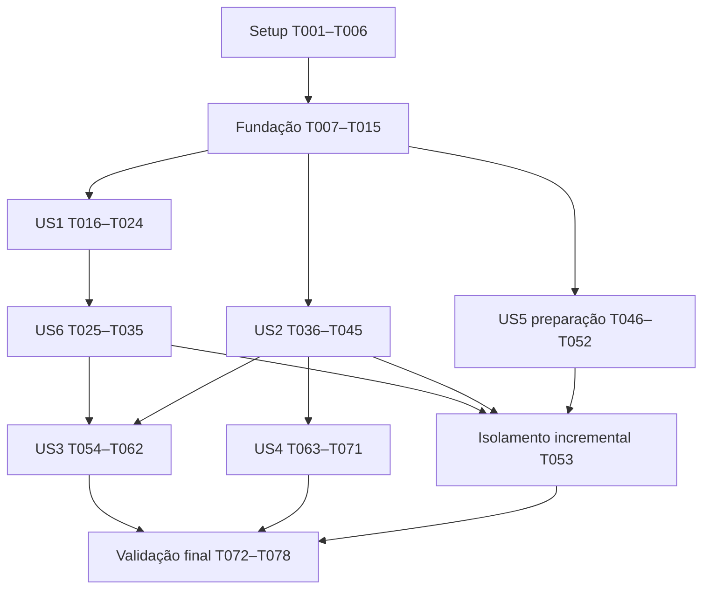

# Tasks: Autenticação, solicitações de cadastro e administração

**Input**: `specs/002-autenticacao-cadastros-admin/` — spec.md, plan.md, research.md, data-model.md, quickstart.md e contracts/.
**Base**: aplicação existente; branch `develop`; nenhuma recriação do projeto, commit ou publicação implícita.
**Organização**: setup → fundação → histórias P1 (US1, US6, US2, US5) → histórias P2 (US3, US4) → validação transversal.
**Testes**: solicitados expressamente pela especificação. Testes unitários verificam comportamento; integração usa SDK cliente e projeto real, sem Firebase Emulator Suite.

## Formato e regras de execução

Cada tarefa usa `- [ ] Tnnn [P?] [USn?] descrição com caminho`. Caminhos são relativos à raiz do repositório. `[P]` indica arquivos separados que podem ser trabalhados em paralelo após os pré-requisitos da respectiva fase; não autoriza execução paralela de mutações no ambiente real.

Ler a constituição vigente e os contratos antes do código. Preservar `.env` sem exibir valores e `.gitignore` sem remover padrões. Não pedir senhas pessoais. Autorização de implementação não implica publicar Rules/Worker ou enviar email real: seguir autorização vigente e registrar dependências operacionais pendentes.

Escrever os testes de cada história antes da implementação correspondente. Executar primeiro os unitários, que devem demonstrar falha comportamental antes da correção. Preparar testes reais sem executá-los contra infraestrutura incompleta; ausência de configuração é bloqueio explícito, nunca aprovação por skip silencioso.

## Fase 1: Setup e governança

**Objetivo**: preparar a base existente e incorporar as exceções já autorizadas, sem ativar serviços.

- [ ] T001 Revisar `.specify/memory/constitution.md`, atualizar versão/data e resumo de impacto para cadastro público, administração informativa, notificação e serviço externo restrito de primeiro acesso; registrar fixtures públicas por manifesto/runId/UID responsável, preservando isolamento, ausência de Blaze e proibição de backend genérico.
- [ ] T002 Inspecionar runtime, scripts e dependências em `package.json` e `package-lock.json`; usar Context7 e documentação oficial para confirmar versões estáveis/engines/peers de Firebase modular, React Router 7, jose e Wrangler, registrando decisões em `specs/002-autenticacao-cadastros-admin/validation.md` sem atualizar dependências existentes indiscriminadamente.
- [ ] T003 Configurar workspace privado `services/trusted-api/package.json`, `services/trusted-api/tsconfig.json`, `services/trusted-api/wrangler.jsonc` e `package.json`, instalar dependências compatíveis em um único `package-lock.json`, separar tipos navegador/Worker e criar scripts typecheck:trusted-api e build:trusted-api com bundle dry-run sem deploy.
- [ ] T004 Preservar `.env` e `.gitignore`, acrescentar somente padrões privados necessários para `.dev.vars`, credenciais e manifestos locais; manter `.env.example` e `services/trusted-api/.dev.vars.example` sem dados reais, verificar rastreamento e documentar eventual remoção do índice separadamente sem apagar arquivo local.
- [ ] T005 Configurar `vitest.config.ts`, `vitest.integration.config.ts` e `package.json` para unitários locais separados de test:integration explícito, incluir testes do Worker e excluir integração do npm test, sem instalar/configurar emuladores.
- [ ] T006 [P] Criar `docs/firebase-operations.md` com preparação do Auth email/senha, projeto esperado, contas dedicadas, papel admin manual, IAM mínimo, secrets, remetente no-reply verificável, limites gratuitos e registro de gates; indicar VITE_ como conteúdo público do bundle, sem cofre de segredos.

**Checkpoint**: revisão constitucional registrada e tooling local preparado. Nenhum serviço considerado provisionado por existir configuração textual.

## Fase 2: Fundação compartilhada

**Objetivo**: estabelecer contratos, infraestrutura e proteção que bloqueiam todas as histórias.

- [ ] T007 [P] Definir DTOs discriminados e erros sanitizados em `src/infrastructure/trusted-api/contracts.ts` e `services/trusted-api/src/contracts.ts`, alinhados a `contracts/api.md`, sem senha/token em respostas, sem aceitar UID/projectId/path/remetente arbitrários.
- [ ] T008 [P] Implementar validação da configuração e singleton em `src/infrastructure/firebase/client.ts`, com Auth browserSessionPersistence e Firestore memoryLocalCache; configuração incompleta deve indicar somente nomes ausentes e impedir inicialização parcial, sem habilitar cache persistente.
- [ ] T009 [P] Implementar entrada restrita e configuração em `services/trusted-api/src/index.ts` e `services/trusted-api/src/environment.ts`: rotas permitidas, CORS por allowlist, JSON até 8 KiB, chaves exatas, no-store, timeouts de 10 s e logging sem corpo/Authorization/PII.
- [ ] T010 Implementar validação de ID token Google com jose em `services/trusted-api/src/googleAuth.ts`, verificando RS256/kid, assinatura, aud/iss fixos, sub, exp/iat/auth_time e conta Auth ativa/revogação pertinente; implementar OAuth de conta de serviço com cache limitado sem expor credenciais.
- [ ] T011 Implementar adaptador REST Firestore de caminhos fixos em `services/trusted-api/src/firestoreRest.ts`, com serialização tipada, timestamps confirmados, transações/precondições e falhas sanitizadas; não disponibilizar endpoint genérico e registrar que OAuth de serviço ignora Security Rules.
- [ ] T012 Gerar `firestore.rules` completo conforme `contracts/security.md`, com perfis próprios mínimos, ready/cutoff, admin manual, oito coleções explícitas e todas as demais/subcoleções negadas; validar campos/datas/versões/referências e nunca aceitar primeiro_login=false ou cutoff fornecido por cliente.
- [ ] T013 Entregar `firestore.indexes.json` completo com compostos de outbox e exclusões de índices pessoais não consultados, e `docs/firestore-rules-changes.md` com matriz, incompatibilidades, snapshot da versão ativa, publicação e rollback seguro; preservar regras/índices existentes necessários após inventário, distinguindo arquivos locais de versões publicadas.
- [ ] T014 [P] Implementar cliente HTTPS em `src/infrastructure/trusted-api/client.ts` com contratos, token somente no header, timeout, operationId estável e erros recuperáveis; nenhuma senha/token/PII em URL, logs ou armazenamento persistente.
- [ ] T015 Criar harness opt-in em `tests/integration/support/environment.ts`, `tests/integration/support/clients.ts` e `tests/integration/support/manifest.ts`, exigindo projectId esperado independente, runId e UIDs dedicados antes de fixtures; isolar A/B/visitante em SDKs clientes com memória e registrar apenas IDs exatos em manifesto local ignorado.

**Checkpoint**: fundação disponível para código das histórias; Rules ainda precisam de inventário/publicação autorizada e testes reais. Não habilitar rotas privadas por antecipação.

## Fase 3: US1 — Entrar e manter uma sessão privada (P1)

**Objetivo**: login, restauração, perfil idempotente e saída sem vazamento entre contas.
**Teste independente**: A/B dedicados, recarga e URL direta; perfil próprio único; estado neutro antes de resolver sessão; logout/troca não exibem dados anteriores. A liberação positiva depende de US6, sem bypass provisório.

### Testes

- [ ] T016 [P] [US1] Escrever testes comportamentais em `src/domain/session.test.ts` para resolving/guest/pendente/ready, perfil inválido, geração antiga e limpeza antes de signOut; nenhuma flag isolada deve liberar acesso.
- [ ] T017 [P] [US1] Preparar `tests/integration/session.integration.test.ts` com perfil ausente e criação concorrente, preservação de createdAt/false, restauração A/B e falhas; usar harness T015 e contas reais dedicadas, sem reset automático de contas preexistentes.

### Implementação

- [ ] T018 [US1] Implementar tipos e transições puras em `src/domain/session.ts`, incluindo schema suportado, pendência por flag ausente e reloginRequired por cutoff inválido/token antigo, sem React ou SDK no domínio.
- [ ] T019 [US1] Implementar login/logout/observer em `src/infrastructure/firebase/auth.ts` e perfil em `src/infrastructure/firebase/profileRepository.ts`, com get confirmado pelo servidor, criação transacional de campos exatos/true e preservação de perfil existente; normalização legada usa endpoint confiável, nunca update livre.
- [ ] T020 [US1] Implementar `src/app/session/SessionProvider.tsx` com resolução Auth → perfil → primeiro acesso → papel, generationId, descarte de respostas tardias e teardown de listeners; nenhuma consulta administrativa antes de sessão pronta.
- [ ] T021 [US1] Implementar `src/app/guards/SessionGate.tsx` e `src/app/router.tsx` com rotas do contrato, estado inicial neutro, destinos internos seguros e página não encontrada; /app permanece bloqueada para pendência ou cutoff não satisfeito.
- [ ] T022 [US1] Criar `src/features/auth/LoginPage.tsx` e adaptar `src/app/App.tsx`, `src/app/AppShell.tsx` e `src/features/home/HomePage.tsx` com mensagens acessíveis, retry e navegação pública/privada; /app exibe apenas shell sem finanças ainda implementadas.
- [ ] T023 [US1] Concluir saída e troca de identidade em `src/app/session/SessionProvider.tsx`: limpar estado/listeners imediatamente, aguardar signOut, fazer location.replace('/login') para descartar cache SDK; falha mantém bloqueio e permite repetir, mudança de UID reinicia página antes de renderizar B.
- [ ] T024 [US1] Validar estados de configuração, login, refresh e logout pelo roteiro de `specs/002-autenticacao-cadastros-admin/quickstart.md`, registrar evidências em `specs/002-autenticacao-cadastros-admin/validation.md`; adiar aprovação do acesso pronto até T035.

**Checkpoint**: US1 funciona até a barreira de primeiro acesso. Entrega privada completa é US1 + US6 + subconjunto de isolamento US5.

## Fase 4: US6 — Atualizar senha no primeiro acesso (P1)

**Objetivo**: credencial provisória → troca protegida → flag/cutoff → logout → login explícito.
**Teste independente**: conta dedicada pendente, dois campos, rejeição da senha atual, nenhuma rota/dado privado antes da conclusão; nova senha autentica somente após novo login. Inclui duas abas e falha Auth/Firestore.

### Testes

- [ ] T025 [P] [US6] Escrever testes de contrato e transições em `services/trusted-api/src/firstLogin.test.ts`, cobrindo campo extra/token inválido, senha atual, erro Auth diferente de INVALID_LOGIN_CREDENTIALS, lease perdido, recibo idempotente, cutoff e falha parcial, usando limites HTTP controlados sem emular Firebase.
- [ ] T026 [P] [US6] Preparar `tests/integration/firstLogin.integration.test.ts` para senha provisória/nova, gravação false negada pelo SDK, URL direta, token de outra aba, relogin no segundo correto e recuperação incerta; usar somente secrets de contas dedicadas sem imprimir senhas.

### Implementação

- [ ] T027 [US6] Implementar operação/lease versionada de 30 s por UID e orçamento de 5 novas tentativas/15 min em `services/trusted-api/src/firstLogin.ts`, persistindo apenas metadados permitidos de firstLoginOperations/operationBudgets e impedindo trabalho após perda de lease.
- [ ] T028 [US6] Implementar prova controlada em `services/trusted-api/src/firstLogin.ts`: token recente ≤5 min, conta password ativa e email real; comparar candidata por signInWithPassword e rejeitar sucesso como SAME_PASSWORD; somente INVALID_LOGIN_CREDENTIALS da conta coerente permite accounts:update; descartar tokens retornados.
- [ ] T029 [US6] Concluir em `services/trusted-api/src/firstLogin.ts` a transação de recibo completed + primeiro_login=false + timestamps/cutoff após sucesso Auth para UID esperado; retry concluído não altera senha e resposta fornece loginAvailableAt, sem confiar em avanço isolado de passwordUpdatedAt.
- [ ] T030 [US6] Implementar recuperação PASSWORD_CHANGE_UNCERTAIN e normalização legada em `services/trusted-api/src/firstLogin.ts`: manter pendência sem recibo, permitir nova operação após lease e novo login com senha efetiva, preservar false confirmado/criação e rejeitar schema desconhecido.
- [ ] T031 [US6] Conectar exclusivamente POST /v1/first-login/change-password e /normalize-profile em `services/trusted-api/src/index.ts`, com DTOs/erros do contrato, sem rota de alteração de terceiros e sem captura de senha, body ou tokens.
- [ ] T032 [US6] Criar `src/features/auth/FirstLoginPage.tsx` com apenas Nova senha e Confirmar nova senha, validação de igualdade/política, operação estável, limpeza de campos, mensagens de recuperação e ação sair; não armazenar senha nem efetuar login automático.
- [ ] T033 [US6] Integrar conclusão/cutoff em `src/app/session/SessionProvider.tsx` e `src/app/router.tsx`, exigindo logout confirmado e nova autenticação após loginAvailableAt; refresh do token, Voltar, papel admin e aba antiga não podem contornar a barreira.
- [ ] T034 [US6] Documentar em `docs/firebase-operations.md` criação manual da conta/credencial provisória, atualização de credenciais dedicadas fora de logs, normalização conhecida e recuperação com outra nova senha se Auth mudou sem recibo; nunca enviar senha no email automático.
- [ ] T035 [US6] Executar unitários US1/US6 e, com gates reais satisfeitos, ciclo e tentativas de bypass de T026; registrar SC-002/SC-011–SC-013 e conclusão conjunta US1/US6 em `specs/002-autenticacao-cadastros-admin/validation.md`, marcando cenários sem ambiente como bloqueados.

**Checkpoint**: nenhum acesso normal sem troca confirmada e autenticação posterior. Não afirmar atomicidade entre Auth e Firestore.

## Fase 5: US2 — Enviar solicitação de cadastro (P1)

**Objetivo**: formulário público com quatro dados, persistência protegida e recibo idempotente, sem conta automática.
**Teste independente**: dados fictícios válidos/inválidos, duplo clique, resposta perdida e payload divergente; exatamente um pedido/operação/outbox por operação, sem leitura pública de PII.

### Testes

- [ ] T036 [P] [US2] Escrever `src/domain/registration.test.ts` cobrindo CPF com dígitos verificadores e sequências repetidas, WhatsApp brasileiro, nome/email/limites e rejeição de campos extras, sem sugerir verificação de titularidade.
- [ ] T037 [P] [US2] Escrever `services/trusted-api/src/registration.test.ts` e preparar `tests/integration/registration.integration.test.ts` para Siteverify inválido/expirado, orçamento concorrente, payload divergente, persistência perdida/replay e impossibilidade de get/list público; testes reais não burlam CAPTCHA.

### Implementação

- [ ] T038 [US2] Implementar validações puras compartilháveis em `src/domain/registration.ts`: CPF normalizado, WhatsApp E.164 +55/DDD2/local9, email trim/normalizado ≤254 e nome trim de 1–150 caracteres, com DTO de quatro dados conforme contratos.
- [ ] T039 [US2] Implementar Siteverify e limites em `services/trusted-api/src/registration.ts`, validando hostname/action registration, HMAC de rede sem IP bruto e contadores transacionais de 20 novas operações/rede/hora e 100 globais/dia UTC; retry existente não consome novo cadastro.
- [ ] T040 [US2] Implementar transação idempotente em `services/trusted-api/src/registration.ts` para registrationRequests, submissionOperations e notificationOutbox, com digest de operationId de 32 bytes, HMAC canônico, timestamps e UUID de entrega estável; mesmo payload retorna recibo, diferente retorna 409 sem PII.
- [ ] T041 [US2] Expor POST /v1/registration-requests em `services/trusted-api/src/index.ts`, confirmando 201/200 somente após commit; rejeitar destinatário/UID/path/campos extras e não criar identidade Auth, vincular por email alegado ou oferecer consulta pública.
- [ ] T042 [US2] Criar `src/features/registration/RegistrationPage.tsx` e `src/features/registration/TurnstileWidget.tsx` com quatro campos obrigatórios, labels/erros, máscara +55 (xx) xxxxx-xxxx, desafio legítimo e operationId preservado em memória para retry; impedir duplo clique sem persistir PII em localStorage.
- [ ] T043 [US2] Criar `src/features/registration/ReceiptPage.tsx` e ligar rotas em `src/app/router.tsx`, exibindo recebimento e criação manual posterior da conta, sem confundir persistência/email/acesso; refresh sem recibo não consulta dados pessoais publicamente.
- [ ] T044 [US2] Acrescentar somente os consumidores implementados VITE_TRUSTED_API_BASE_URL e VITE_TURNSTILE_SITE_KEY em `src/vite-env.d.ts`, `.env.example` e documentação `README.md`, preservando valores existentes de `.env` e apontando configuração ausente sem inventar dados.
- [ ] T045 [US2] Executar unitários/contratos e, quando autorizado e configurado, envio fictício e replay legítimo pelo roteiro em `specs/002-autenticacao-cadastros-admin/quickstart.md`; registrar SC-003/SC-010 em `specs/002-autenticacao-cadastros-admin/validation.md` sem declarar email validado nesta história.

**Checkpoint**: solicitação existe com outbox pending; ausência de remetente não perde o pedido e não equivale a conta criada.

## Fase 6: US5 — Verificar Rules e isolamento no projeto real (P1)

**Objetivo**: preparar e executar matriz real A/B/visitante com alvo conferido e limpeza limitada.
**Teste independente**: alvo divergente aborta antes de fixtures; SDK cliente comprova permissões e negações; manifesto delimita cada documento e dependência. Casos administrativos/email são concluídos após US3/US4.

### Testes e implementação da suíte

- [ ] T046 [P] [US5] Escrever testes locais de alvo/manifesto em `tests/integration/support/environment.test.ts` e `tests/integration/support/manifest.test.ts`, verificando abort antes de escrita, UIDs allowlist, IDs exatos e recusa de escopo não pertencente à execução, sem conexão Firebase.
- [ ] T047 [P] [US5] Implementar `tests/integration/access.integration.test.ts` com SDK cliente real para get/list/create/update/delete de perfis próprios/alheios, admin manual, flags/cutoff/schema/createdAt e oito coleções/subcoleções financeiras futuras; comparar operações permitidas com todas as negações esperadas.
- [ ] T048 [P] [US5] Preparar `tests/integration/admin.integration.test.ts` para A manualmente admin pronto, B comum e visitante, paginação/limite, assinatura válida/inválida/concorrente, vínculo confiável e remoção de papel; nunca promover A pelo cliente testado.
- [ ] T049 [P] [US5] Preparar `tests/integration/trusted-api.integration.test.ts` para projeto/token incorretos, expiração/conta desabilitada, campos/UID injetados, relay arbitrário, quotas e replay; separar evidência do serviço privilegiado da prova de Rules pelo SDK.
- [ ] T050 [US5] Implementar `scripts/cleanup-integration.mts` com projectId/runId/UIDs/manifesto explícitos, dry-run inicial e listagem de IDs/quantidades, credencial operacional separada e remoção somente de fixtures/dependências selecionadas; não apagar contadores globais, papéis preexistentes ou contas Authentication, nem presumir cascata de subcoleções.
- [ ] T051 [US5] Concluir execução opt-in e procedimento em `vitest.integration.config.ts`, `package.json` e `docs/firebase-operations.md`, incluindo secrets locais ignorados, ausência de credenciais como bloqueio e restauração manual do papel de teste ao estado anterior.
- [ ] T052 [US5] Inventariar e salvar Rules/índices ativos conforme `docs/firestore-rules-changes.md`, revisar IAM dedicado sem Owner/Editor e compatibilidade com o código; publicar somente com autorização vigente e confirmar alvo/versão em `specs/002-autenticacao-cadastros-admin/validation.md`, ou registrar bloqueio sem substituir regras remotas desconhecidas.
- [ ] T053 [US5] Executar subconjunto real US1/US6/US2 de T047/T049 após T035/T045/T052 e registrar resultados por operação em `specs/002-autenticacao-cadastros-admin/validation.md`; manter explicitamente pendentes os casos US3/US4 até T074, sem anunciar a suíte inteira aprovada.

**Checkpoint**: código de toda a matriz preparado; validação real incremental documentada. US5 só fica concluída após a execução final T074.

## Fase 7: US3 — Consultar solicitações e registrar assinatura (P2)

**Objetivo**: admin por UID manual consulta dados cadastrais e registra período informativo com concorrência segura.
**Teste independente**: A admin pronto lista/detalha/salva; B/visitante são negados por URL e SDK; remoção do papel nega nova operação; datas não afetam login.

### Testes

- [ ] T054 [P] [US3] Escrever `src/domain/subscription.test.ts` para datas reais/bissextos, ambas obrigatórias, fim ≥ início, versão +1 e invariância das permissões perante datas ausentes/futuras/vencidas.
- [ ] T055 [P] [US3] Escrever testes comportamentais de edição em `src/features/admin/subscriptionEditor.test.ts`, cobrindo confirmação pendente, resposta tardia, conflito de versão e remoção de permissão sem manter dados privados na tela; complementar cenários reais preparados em `tests/integration/admin.integration.test.ts`.

### Implementação

- [ ] T056 [US3] Implementar tipos/validação de calendário e período em `src/domain/subscription.ts`, sem UTC, SDK ou regra de expiração de acesso; manter requestId/criação imutáveis e versão inteira.
- [ ] T057 [US3] Implementar `src/infrastructure/firebase/adminRepository.ts` com get do papel próprio, pedidos em páginas de 25 ordenadas por createdAt/documentId com cursor, detalhe/outbox por ID e assinatura transacional com versão observada; preservar dados originais e detectar conflito antes de sobrescrever.
- [ ] T058 [US3] Criar `src/app/guards/AdminGate.tsx` e integrar `src/app/session/SessionProvider.tsx`, observando papel próprio atual somente após ready; remover/desativar papel ou receber permission-denied limpa dados administrativos e bloqueia próxima operação.
- [ ] T059 [US3] Criar `src/features/admin/RequestsPage.tsx` com navegação por cursor, estados carregando/vazio/erro, identificação da solicitação e acesso ao detalhe, sem listener sobre todo histórico ou consulta financeira.
- [ ] T060 [US3] Criar `src/features/admin/RequestDetailPage.tsx` e `src/features/admin/subscriptionEditor.ts` para quatro dados somente leitura, estado da notificação e início/fim editáveis; salvar com pending, confirmação de servidor e conflito que pede recarga, sem edição de papel ou criação de conta.
- [ ] T061 [US3] Integrar URLs administrativas e links condicionais em `src/app/router.tsx` e `src/app/AppShell.tsx`, sem expor conteúdo antes de perfil/primeiro acesso/papel resolvidos e sem associar datas de assinatura a autorização.
- [ ] T062 [US3] Executar testes locais e casos reais T048 com A/B/visitante quando gates permitirem; registrar consulta, concorrência, perda de papel e SC-004/SC-010 em `specs/002-autenticacao-cadastros-admin/validation.md`, sem conceder acesso financeiro ao admin.

**Checkpoint**: administração limitada ao cadastro e período; conta e papel continuam provisionados manualmente fora do aplicativo.

## Fase 8: US4 — Receber aviso de nova solicitação (P2)

**Objetivo**: envio real pelo serviço gratuito com outbox durável, destinatário fixo e recuperação sem duplicação deliberada.
**Teste independente**: uma solicitação fictícia persiste e tem aceite real do provedor; falha/cota mantém pedido e status honesto; abandono do navegador não impede cron. No máximo dois avisos reais por execução.

### Testes

- [ ] T063 [P] [US4] Escrever `services/trusted-api/src/notifications.test.ts` para payload fixo sem PII, lease concorrente, limite de tentativas, sucesso/deduplicação, cota e timeout dentro/fora da janela, verificando que accepted não significa inbox.
- [ ] T064 [P] [US4] Preparar `tests/integration/notifications.integration.test.ts` com runId/manifesto e habilitação explícita do envio, no máximo duas notificações reais, mesma operação para testar dedupe e resultado registrado sem expor secrets nem reenviar após incerteza fora da janela.

### Implementação

- [ ] T065 [US4] Implementar adaptador Brevo HTTPS em `services/trusted-api/src/notifications.ts` com remetente configurado/verificado, destinatário servidor fixo luizgustavo.dev01@gmail.com e template de referência/data/URL admin; proibir conteúdo arbitrário e CPF/WhatsApp/senhas no aviso.
- [ ] T066 [US4] Implementar máquina de outbox em `services/trusted-api/src/notifications.ts`, com lease transacional, payload/template e UUID estáveis em headers.idempotencyKey do payload Brevo; persistir accepted/providerMessageId ou accepted_deduplicated sem fabricar ID.
- [ ] T067 [US4] Implementar retry/recuperação em `services/trusted-api/src/notifications.ts`: máximo 5 tentativas, timeout incerto reaproveita chave só até 25 min do primeiro dispatch, depois uncertain e reconciliação manual; erro/cota gera pendência/falha sanitizada sem apagar pedido ou ativar plano pago.
- [ ] T068 [US4] Ligar scheduled handler em `services/trusted-api/src/index.ts` e um cron de 5 min em `services/trusted-api/wrangler.jsonc`, consultando no máximo 5 itens por invocação com índices/leases, incluindo recuperação de lease expirado; não depender de waitUntil ou expor cron/reenvio privilegiado publicamente.
- [ ] T069 [US4] Conectar estado real de notificação em `src/features/admin/RequestDetailPage.tsx` e recibo em `src/features/registration/ReceiptPage.tsx`, distinguindo recebido/pending/accepted/failed/uncertain sem alegar entrega na caixa de entrada.
- [ ] T070 [US4] Revalidar cotas oficiais e documentar evidência de remetente/conta Brevo, IAM/secrets e medição real de CPU/cold start/subrequests do Worker em `docs/firebase-operations.md` e `specs/002-autenticacao-cadastros-admin/validation.md`; interromper ativação se plano gratuito não comportar, sem contratar ou inventar domínio/remetente.
- [ ] T071 [US4] Executar testes locais e, com configuração/autorização vigentes, T064 e abandono do navegador/retomada por cron; registrar SC-005, aceite e inbox separadamente em `specs/002-autenticacao-cadastros-admin/validation.md`, ou bloquear explicitamente o canal sem perder o pedido.

**Checkpoint**: notificação somente validada com serviço/remetente reais e evidência; outbox gravada sozinha não comprova envio.

## Fase 9: Acabamento e validação transversal

- [ ] T072 [P] Atualizar `README.md`, `docs/firebase-operations.md` e `specs/002-autenticacao-cadastros-admin/quickstart.md` com instalação/comandos finais, ambiente público/privado, criação manual/admin, política de senha/recuperação, fallback SPA para URLs e limites/bloqueios conhecidos, sem valores reais.
- [ ] T073 Verificar navegação e formulários a 360/1280 pixels e por teclado em `src/shared/styles/global.css`, `src/app/AppShell.tsx` e páginas das quatro funcionalidades, corrigindo labels/foco/erro/loading sem ornamentação ou novas bibliotecas visuais; registrar evidência em `specs/002-autenticacao-cadastros-admin/validation.md`.
- [ ] T074 Concluir US5 executando matriz SDK real e endpoints após US3/US4 e Rules confirmadas, incluindo admin revogado, perfil alheio, finanças/subcoleções negadas e token provisório de outra aba; registrar cada caso aprovado/falhou/bloqueado em `specs/002-autenticacao-cadastros-admin/validation.md` sem confundir OAuth privilegiado com teste de Rules.
- [ ] T075 Executar npm ci, typecheck, typecheck:trusted-api, lint, npm test, build e build:trusted-api conforme `package.json`; corrigir falhas e registrar versões/comandos/resultados em `specs/002-autenticacao-cadastros-admin/validation.md`, sem deploy no build.
- [ ] T076 Auditar `.gitignore`, `.env.example`, `services/trusted-api/.dev.vars.example`, código e artefatos `dist/` quanto a secrets/senhas/PII e rastreamento de arquivos privados; registrar SC-008 em `specs/002-autenticacao-cadastros-admin/validation.md` sem imprimir valores sensíveis ou remover `.env` local.
- [ ] T077 Executar dry-run de `scripts/cleanup-integration.mts` com manifesto da execução, revisar IDs/quantidades e limpar somente esse escopo quando autorizado; registrar resultado/restos e restauração manual do papel em `specs/002-autenticacao-cadastros-admin/validation.md`, sem exclusão global ou de dados preexistentes.
- [ ] T078 Consolidar SC-001–SC-013 e cobertura FR-001–FR-034 em `specs/002-autenticacao-cadastros-admin/validation.md`, distinguindo código gerado, Rules/índices publicados, serviço ativo, testes executados e bloqueios; reconciliar `specs/002-autenticacao-cadastros-admin/tasks.md` somente com evidências, sem marcar tarefa real bloqueada como concluída.

## Dependências e ordem de execução

- Setup e fundação precedem código das histórias. T006 pode avançar após T002 enquanto o workspace é configurado; T007/T008/T009/T014 usam arquivos distintos; T010 depende de T007/T009 e T011 de T010. T012 antecede T013. T015 depende de T005/T008.
- Dentro de cada história: testes → domínio → repositório/serviço → integração de rotas/UI → validação. `[P]` só libera atividades sem dependência de resultado incompleto. Edições compartilhadas de router, SessionProvider, index.ts e documentação são serializadas.
- US1 implementa primeiro a barreira; US6 conclui o acesso. T024 não libera MVP sem T035 e negações SDK correspondentes de US5. T026/T035 não exigem cadastro/admin/email prontos.
- US2 pode ser construída após fundação em paralelo ao conjunto US1/US6, sem autenticação obrigatória. Sua persistência/outbox precisa existir antes da integração de US4. US3 pode ser testada com uma solicitação fictícia identificada do fluxo US2.
- US5 tem prioridade P1: preparar T046–T052 cedo e executar T053 antes da entrega privada. T048/T049 descrevem cenários futuros que somente serão aprovados com respectivas histórias implementadas; T074 fecha a matriz.
- US4 pode ser desenvolvida junto de US3 após US2; T069 depende de T060 para integrar estado no detalhe. Não editar o mesmo arquivo simultaneamente.
- T052 e todas as execuções reais dependem de gates de ambiente e autorização vigentes. Sem eles, avançar código/verificações locais e registrar bloqueio; não publicar automaticamente. T070 mede o plano gratuito antes de ativação operacional. T077 é limpeza delimitada, nunca pré-requisito que autorize apagar dados agora.

## Exemplos de paralelismo por história

Os pares abaixo são oportunidades de arquivos separados, com pré-requisitos da fase já concluídos; não são instrução para criar agentes nem executar suítes reais simultâneas.

| História | Exemplo independente | Integração serial posterior |
| --- | --- | --- |
| US1 | T016 domínio/sessão e T017 roteiro SDK | T018–T023 integram provider e router |
| US6 | T025 contrato do serviço e T026 roteiro real | T027–T033 integram prova e UI |
| US2 | T036 validação pura e T037 contratos/roteiro real | T038–T043 integram serviço e formulário |
| US5 | T046 guardas locais, T047 Rules, T048 admin e T049 API em arquivos próprios | T051–T053 coordenam execução; T074 fecha matriz |
| US3 | T054 calendário e T055 comportamento do editor | T056–T061 integram repositório/guard/telas |
| US4 | T063 máquina de outbox e T064 roteiro email real | T065–T069 integram provedor/cron/UI |

## Estratégia de implementação e MVP

1. Entregar setup/fundação com constituição revisada e arquivos completos de Rules/índices prontos para revisão.
2. Construir US1 + US6 e executar o subconjunto de US5 que comprova perfil próprio, bloqueio pendente, troca protegida e sessão posterior. Esse é o **MVP seguro**; US1 isolada não atende ao primeiro acesso obrigatório.
3. Adicionar US2, validando persistência/idempotência independentemente do envio. O aviso pode permanecer pending com canal explicitamente bloqueado, sem declarar US4 concluída.
4. Adicionar US3 e US4 como incrementos P2. Datas não controlam acesso; remetente/cota são gates operacionais, não garantias geradas pelo código.
5. Concluir US5 e acabamento com evidência por critério. Bloqueios externos permanecem abertos e documentados; código compilável não substitui integração testada.

## Rastreabilidade e contagem

| Área | Tarefas | Quantidade | Requisitos principais |
| --- | --- | --- | --- |
| Setup | T001–T006 | 6 | Governança, FR-001/017/023/025/027 |
| Fundação | T007–T015 | 9 | FR-001/002/020–FR-023/026/028/032 |
| US1 | T016–T024 | 9 | FR-003–FR-007/026/029/030 |
| US6 | T025–T035 | 11 | FR-027/029–FR-034 |
| US2 | T036–T045 | 10 | FR-008–FR-011/026/028 |
| US5 | T046–T053 | 8 | FR-020–FR-025/034 |
| US3 | T054–T062 | 9 | FR-012–FR-015/026 |
| US4 | T063–T071 | 9 | FR-016–FR-019/026 |
| Transversal | T072–T078 | 7 | SC-001–SC-013, documentação/evidência |
| **Total** | **T001–T078** | **78** | **34 FR e 13 SC** |

Critérios de teste independente constam de cada fase. Publicação e execução não realizadas durante a geração destas tarefas; todos os checkboxes começam abertos.
