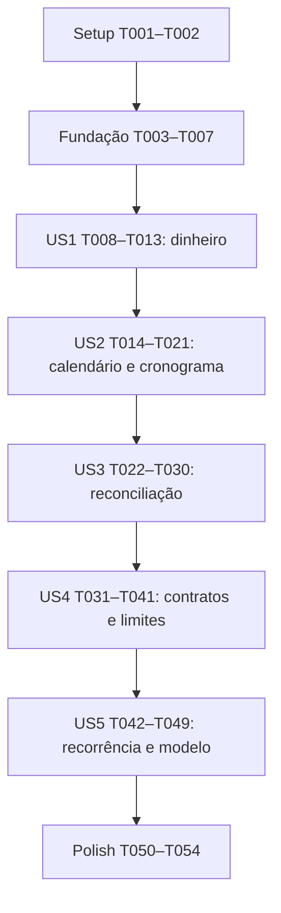

# Tasks: Núcleo financeiro compartilhado

**Input**: [plan.md](plan.md), [spec.md](spec.md), [research.md](research.md), [data-model.md](data-model.md), [contracts/domain.md](contracts/domain.md), [contracts/repositories.md](contracts/repositories.md) e [quickstart.md](quickstart.md).

**Prerequisites**: Constituição 1.2.0, contexto ativo `specs/003-nucleo-financeiro-compartilhado`, dependências existentes e ambiente Node compatível. Não criar projeto/workspace novo nem atualizar dependências indiscriminadamente. Git real permanece `develop` salvo instrução posterior.

**Tests**: Incluídos porque spec, plano e constituição exigem testes locais de cálculos e contratos. Escrever os casos da fase antes de implementar a capacidade e observar a falha relevante; não manter testes skipped/todo para aparentar conclusão. Nenhum teste remoto é necessário para esta feature.

**Organization**: Oito fases, cinco histórias nas prioridades originais. Caminhos de código são relativos à raiz `C:/Projetos/LilicaFinancy`; documentação da feature também usa caminhos relativos. Todas as tarefas começam pendentes; gerar esta lista não executa implementação.

## Format: `[ID] [P?] [Story] Description`

`[P]` indica arquivo distinto de outras tarefas da mesma janela e execução possível após os pré-requisitos explícitos. Não autoriza ignorar dependências ou iniciar agentes automaticamente. `[US1]` a `[US5]` correspondem às histórias da especificação. Tarefas que modificam o mesmo arquivo são sequenciais, mesmo quando pertencem a histórias diferentes.

## Phase 1: Setup — preservar a base existente

**Purpose**: Registrar alvo e proteger os limites de escopo antes de alterar código.

- [ ] T001 Conferir contexto da feature, runtime, scripts e estado Git; criar `specs/003-nucleo-financeiro-compartilhado/validation.md` com ambiente, comandos planejados, estado inicial e hashes de `firestore.rules`, `firestore.indexes.json` e arquivos rastreados de `services/trusted-api/`, sem ler/imprimir segredos ou executar integração; registrar também `package.json`/`package-lock.json` para detectar mudanças não previstas.
- [ ] T002 Atualizar `src/domain/README.md` com a fronteira do núcleo e sequência de entrega, reconhecendo os módulos existentes de sessão/assinatura e os contratos apenas documentais, sem afirmar que arquivos financeiros ainda não implementados já funcionam.

## Phase 2: Foundational — valores compartilhados e fronteira

**Purpose**: Resultado tipado e validação civil mínima compartilhada por ajustes e cronogramas. Não antecipar entidades persistidas, SDK ou repositório genérico.

- [ ] T003 [P] Criar testes de resultado discriminado, códigos de erro e serialização sem payload pessoal em `src/domain/finance/errors.test.ts`, conforme o envelope de `contracts/domain.md`, sem tratar falha como sucesso vazio.
- [ ] T004 Implementar `Resultado<T>` e erros de domínio/repositório em `src/domain/finance/errors.ts`, incluindo campo/limite/versão e orientação de recuperação quando aplicável, consumidos pelos testes T003; sem logger ou exceção para entrada pública inválida.
- [ ] T005 [P] Implementar o gate em `src/domain/finance/architecture.test.ts`: percorrer imports transitivos de módulos de produção, resolver caminhos locais e negar React/Firebase/app/features/infraestrutura/Node-only, acesso a relógio global e import dinâmico não declarado; excluir código de teste dessa restrição e validar o detector com grafos sintéticos permitidos/proibidos, sem depender só de busca textual por nomes de pacotes.
- [ ] T006 [P] Criar os casos de validação civil em `src/domain/finance/calendar.test.ts` para formato, faixa 1900–9999, dias inexistentes e séculos 1900/2000/2100; construtores devem receber entradas inválidas de execução, não apenas strings tipadas.
- [ ] T007 Implementar em `src/domain/finance/calendar.ts` os tipos nominais e construtores de DataCalendario/Competencia, ano bissexto e diasNoMes para satisfazer T006, sem Date para calendário e sem implementar antecipadamente fuso/cronograma; depender de T004.

**Checkpoint**: T001–T007 concluídas antes de iniciar implementação das histórias. O calendário básico fica nesta fase porque ajustes tipados e cronogramas compartilham suas datas; avanço/fuso pertencem à US2.

## Phase 3: User Story 1 — Valores e divisão exata (Priority: P1) — MVP

**Goal**: Validar, apresentar e operar dinheiro sem perda de centavos, aceitando redução somente por crédito tipado.

**Independent Test**: Executar `money.test.ts` e `moneyCredit.test.ts` com a fundação, sem outras histórias, rede ou interface: roundtrip até MAX; 10000/3=[3334,3333,3333]; negativo/overflow rejeitados; crédito tipado500 reduz saldo1000 para500 e `-5,00` não é valor livre aceito.

### Tests for User Story 1

- [ ] T008 [P] [US1] Criar tabelas e invariantes em `src/domain/finance/money.test.ts` para construtores numéricos, gramática pt-BR integral, prefixo/espaços, zero versus fato positivo, MAX/MAX−1/MAX+1, ida/volta exata, soma/subtração/multiplicação e distribuição N=1..12 com BigInt como oráculo, incluindo rejeição T<N e estouro intermediário.
- [ ] T009 [P] [US1] Criar `src/domain/finance/moneyCredit.test.ts` para crédito explicitamente discriminado com magnitude positiva, motivo, origem e DataCalendario válidos; verificar redução exata, limite ao saldo, rejeição de sinal negativo e preservação das entradas, sem simular caixa/persistência.

### Implementation for User Story 1

- [ ] T010 [US1] Implementar Centavos/ValorPositivo e parser pt-BR sobre dígitos em `src/domain/finance/money.ts`, recebendo unknown, validando inteiro seguro e normalizando zero; BigInt pode ser intermediário interno e nunca escapar para DTO/JSON.
- [ ] T011 [US1] Acrescentar em `src/domain/finance/money.ts` formatação canônica por dígitos, comparação, soma, subtração não negativa, multiplicação, diferença tipada e distribuição por quociente/resto nas primeiras parcelas, com checagem de cada intermediário conforme T008; depender de T010.
- [ ] T012 [US1] Acrescentar em `src/domain/finance/money.ts` a operação pura mínima de crédito tipado que valida magnitude, motivo, origem e data usando T007 e reduz uma magnitude de saldo sem underflow; consumi-la em T009 e posteriormente em settlement, sem recibo, pagamento, CRUD ou novo serviço de ajuste.
- [ ] T013 [US1] Executar os dois arquivos de teste da US1 e o gate de arquitetura; registrar em `specs/003-nucleo-financeiro-compartilhado/validation.md` resultados reais, falhas e evidência de roundtrip do máximo, sem alegar criação de ajuste remoto.

**Checkpoint**: MVP é dinheiro e crédito aritmético tipado verificáveis localmente. A operação mínima de T012 não substitui a avaliação de fatos/pendência/origem no contexto completo da US3.

## Phase 4: User Story 2 — Calendário, competências e cronogramas (Priority: P1)

**Goal**: Avançar meses mantendo âncora, tratar fuso na borda e gerar cronogramas/faturas sem UTC acidental.

**Independent Test**: Após fundação e US1, executar calendar/installments/invoiceCalendar: janeiro31→fevereiro28→março31; virada dezembro/janeiro; bissextos; migração5/10; sugestão no fechamento; mesmo resultado para datas civis em fusos diferentes.

### Tests for User Story 2

- [ ] T014 [P] [US2] Ampliar `src/domain/finance/calendar.test.ts` com avanço positivo/zero/negativo, limites da faixa, âncoras29/30/31, instante explícito, IANA/aliases/UTC, offsets rejeitados e Rio Branco/Tokyo; demonstrar que mudar fuso não altera string civil e que não se usa relógio implícito.
- [ ] T015 [P] [US2] Criar `src/domain/finance/invoiceCalendar.test.ts` para compra antes/no/depois do fechamento, vencimento no mesmo/próximo mês, dias inexistentes, primeira fatura explícita e calendário confirmado preservado ao alterar o cartão.
- [ ] T016 [P] [US2] Criar `src/domain/finance/installments.test.ts` para soma exata, ordinais/âncora, quantidades1/12/13, migração5/10, valores individuais conhecidos completos, total original ausente e planejamento externo deslocado sem modificar vencimento; exigir vencimento da parcela de cartão idêntico ao da fatura e rejeitar cópia divergente; sem pagamentos passados inventados.

### Implementation for User Story 2

- [ ] T017 [US2] Completar `src/domain/finance/calendar.ts` com competenciaDaData, avancarCompetencia, dataNaCompetencia, avancarMes, validarFuso e hojeNoFuso, usando componentes inteiros e Intl.formatToParts apenas para instante→dia, sem offsets explícitos ou fallback ao navegador; depender de T014 e T007.
- [ ] T018 [US2] Delegar `calendarDate`/`validatePeriod` em `src/domain/subscription.ts` ao calendário compartilhado e ampliar `src/domain/subscription.test.ts` para compatibilidade de assinatura/resultado e limites; executar regressão sem alterar a lógica de assinatura administrativa; depender de T017.
- [ ] T019 [P] [US2] Implementar `src/domain/finance/invoiceCalendar.ts` conforme FR-013 e T015, preservando primeira fatura explícita e snapshots de calendário, retornando proposta e não gravando faturas; depender de T017 e US1.
- [ ] T020 [P] [US2] Implementar `src/domain/finance/installments.ts` conforme T016, reutilizando distribuição monetária e âncora original para cada offset externo, com uniões nova/migrada; no cartão, usar o vencimento da fatura como autoridade e validar igualdade exata da cópia na parcela; depender de T017 e US1, sem depender da gravação de faturas.
- [ ] T021 [US2] Executar testes da US2 e de assinatura, incluindo o cenário com TZ alternativo descrito em `specs/003-nucleo-financeiro-compartilhado/quickstart.md`; registrar resultados em `specs/003-nucleo-financeiro-compartilhado/validation.md` e restaurar variável TZ ao final.

**Checkpoint**: Cronograma completo é proposta pura. Não se confunde cronograma calculado com série persistida ou primeira fatura sugerida com calendário já confirmado.

## Phase 5: User Story 3 — Consumo, compromissos e caixa (Priority: P1)

**Goal**: Derivar estados e valores pendentes de origens/fatos completos, sem dupla contagem e com as duas clarificações preservadas.

**Independent Test**: Após US1/US2, reconciliar fixtures finitas: compra10000/3, fatura fechada com4000 pago, receita100000 com60000 recebido, inversões/créditos e estorno em mês posterior. Nenhum repositório real ou US4 é necessário.

### Tests for User Story 3

- [ ] T022 [P] [US3] Criar `src/domain/finance/settlement.test.ts` com obrigação ativa/cancelada, estados pendente/parcial/liquidada/semExigibilidade, ciclo independente, atraso por hoje explícito, crédito e inversões, reembolso+estorno atômico, limite compartilhado de reversões do original e bloqueio de pagamento direto da parcela de cartão; incluir snapshots incompletos/adulterados, vencimento de parcela divergente da fatura rejeitado como referenciaInvalida e rejeição de soma insegura.
- [ ] T023 [P] [US3] Criar `src/domain/finance/projections.test.ts` reconciliando consumo/planejamento/caixa, categoria na origem, estorno outubro→novembro, crédito filho que não repete consumo, planejamento outubro/vencimento novembro, resultado líquido tipado e migração sem data/total; páginas incompletas não podem emitir total definitivo.

### Implementation for User Story 3

- [ ] T024 [US3] Definir em `src/domain/finance/contracts/commands.ts` somente tipos/snapshots discriminados consumidos pelos cálculos desta história: origens nova/migrada, compromissos, fatura, fatos, créditos/estornos e guards de versão; preservar fontes de verdade do `data-model.md` sem gerar runtime CRUD/schema para todas as entidades futuras.
- [ ] T025 [US3] Implementar em `src/domain/finance/settlement.ts` construção/validação de snapshots completos, IDs únicos, referências/mesmo escopo, schema conhecido, dados suficientes e revisão consistente; rejeitar parcela de cartão cujo vencimento difira da fatura, sem corrigir silenciosamente qualquer data; snapshot parcial deve preservar motivo e impedir liquidação/total definitivo, sem aceitar booleano alegado como prova de autorização remota; depender de T024.
- [ ] T026 [US3] Acrescentar em `src/domain/finance/settlement.ts` derivarLiquidacao e avaliação de pagamentos/recebimentos parciais com valor exigível/líquido/pendente seguros, atraso e liquidaçãoViaFatura sem rateio inventado; usar T025, dinheiro/calendário e satisfazer T022.
- [ ] T027 [US3] Acrescentar em `src/domain/finance/settlement.ts` avaliação de correções tipadas, cancelamento permitido e grupo de estorno/créditos/reembolso, reaproveitando crédito mínimo da US1; validar mapa explícito, soma/vínculos e estado final sem saldo credor ou efeitos de caixa duplicados, preservando fatos originais; depender de T026.
- [ ] T028 [US3] Acrescentar em `src/domain/finance/settlement.ts` prévia de edição `estaOcorrencia`/`estaEFuturasNaoLiquidadas`, devolvendo IDs/versões/impacto e bloqueando reescrita de pagos/fatura fechada, cancelamento parcial de origem ou edição independente do vencimento da parcela de cartão; testar cenários em `src/domain/finance/settlement.test.ts`, sem oferecer update genérico.
- [ ] T029 [US3] Implementar `src/domain/finance/projections.ts` com base temporal explícita, rastreabilidade e completude, contando origem no consumo, compromissos no planejamento e fatos no caixa; estorno usa mês de dataEfeito e planejamento externo independe do vencimento; valores sem data/total ficam identificados, não inferidos; depender de T026–T028 e T023.
- [ ] T030 [US3] Executar a reconciliação da US3 e registrar em `specs/003-nucleo-financeiro-compartilhado/validation.md` valores esperados/obtidos, consumo original preservado, pendências exatas e ausência de pagamento/recebimento duplicado; não confundir resultado mensal com saldo bancário.

**Checkpoint**: Regras operam sobre snapshots validados e não confirmam transação remota. Origem de compra, cronograma, obrigação, ciclo e fatos de caixa continuam separados.

## Phase 6: User Story 4 — Idempotência, conflitos e limites (Priority: P1)

**Goal**: Definir portas consumidas por cenários de teste e provar rejeição integral/retomada local, sem habilitar adaptadores financeiros.

**Independent Test**: Após US1–US3, doubles finitos devem demonstrar mesma chave→mesmos IDs, payload divergente→conflito, expectedVersion3 concorrente→uma confirmação4 e nenhuma série parcial. Catálogo remoto permanece naoHabilitado.

### Tests for User Story 4

- [ ] T031 [P] [US4] Criar `src/domain/finance/identity.test.ts` com tuplas tipadas, colisões de concatenação evitadas, IDs naturais estáveis, versão k1, limites de bytes e canonicalização de objetos/conjuntos versus ordem de arrays; rejeitar undefined/BigInt/NaN/campos inesperados e assegurar que dados pessoais não viram IDs.
- [ ] T032 [P] [US4] Criar `src/domain/finance/operationBudget.test.ts` com quantidade12/13, ocorrências12/13, mutações32/33, bytes exatos/acima, documentos32KiB, acessos18/19 e8/9, expressões1000/1001, perfil ausente/desconhecido e casos de26 acessos; perfis sintéticos nunca habilitam o catálogo remoto.
- [ ] T033 [P] [US4] Especificar cenários em `src/domain/finance/contracts/series.contract.test.ts` para mesma chave, payload distinto, origem/ordinal/fatura únicos, versões, último ordinal ausente e falhas antes/depois do commit; usar fixture de cronograma validada por US2/US3, sem gravar Firebase.
- [ ] T034 [P] [US4] Especificar cenários em `src/domain/finance/contracts/settlement.contract.test.ts` para dois pagamentos sobre o mesmo saldo, duas inversões sobre o mesmo original, schema incompatível, referência de outro UID e consulta de operação ausente confirmada versus indeterminada, sem tratar versão como prova de saldo remoto.

### Implementation for User Story 4

- [ ] T035 [P] [US4] Implementar em `src/domain/finance/identity.ts` codec de tupla JSON compacto UTF-8/base64url compatível browser/Node sem Buffer e canonicalização do comando validado, com limites de IDs/payload16KiB e chave fornecida pelo chamador; IDs e BigInt não são gerados/serializados implicitamente.
- [ ] T036 [P] [US4] Implementar `src/domain/finance/operationBudget.ts` com tetos do aplicativo, estimativa explícita de pior caso incluindo metadados/guards/recibo/validações, rejeição de contagens inválidas e perfil não comprovado, sem presumir cache; todos os perfis financeiros de produção devem retornar naoHabilitado, usando perfis sintéticos somente como argumentos dos testes.
- [ ] T037 [US4] Ampliar `src/domain/finance/contracts/commands.ts` com envelopes, recibos imutáveis e portas específicas efetivamente consumidas pelos testes de série/liquidação/consulta de operação, resultados comuns sem tipos do provedor e conflitos de schema/versão/idempotência; reutilizar identidade/snapshots/orçamento de T035/T036/US3, sem adicionar classe CRUD ou portas sem consumidor.
- [ ] T038 [P] [US4] Completar `src/domain/finance/contracts/series.contract.test.ts` com double finito local e atomicidade de origem+parcelas+faturas+guards+recibo, retornando recibo existente antes de revalidar expectedVersion, simulando falha pré-commit e resposta perdida pós-commit; validar origens/ordinais/faturas únicas e consultar mesma chave na retomada; depender de T037, T033 e módulos puros.
- [ ] T039 [P] [US4] Completar `src/domain/finance/contracts/settlement.contract.test.ts` com double específico de alvo/fatos/recibos que aplica propostas puras e coordena todos os guards, aceita uma intenção concorrente e rejeita excedentes/inversões duplicadas; manter dados finitos e lógica de negócio nos módulos do domínio, não em um banco simulado genérico; depender de T037 e T034.
- [ ] T040 [US4] Criar `src/domain/finance/contracts/read.contract.test.ts` e os tipos de leitura consumidos em `src/domain/finance/contracts/commands.ts`, exercitando páginas1..50, desempate temporal+ID, cursor preso ao UID/base/filtro, mudança de revisão e snapshot incompleto sem total definitivo, sem implementar consulta remota; depender de T037–T039 e projeções da US3.
- [ ] T041 [US4] Executar contratos/orçamentos da US4 e registrar em `specs/003-nucleo-financeiro-compartilhado/validation.md` resultados e limites da evidência; confirmar rejeição de perfil remoto ausente, de13 parcelas e de comando de26 acessos sem sugerir8 parcelas como capacidade aprovada.

**Checkpoint**: Doubles provam comportamento local. Nenhum comando financeiro ganha adaptador Firestore, rota no trusted-api, coleção liberada, índice ou protocolo multietapas.

## Phase 7: User Story 5 — Contratos reutilizáveis e recorrência (Priority: P2)

**Goal**: Completar projeção/materialização idempotente de ocorrências e exercitar relações do modelo sem persistir entidades sem funcionalidade.

**Independent Test**: Após capacidades anteriores, fixture A/B com titulares homônimos permanece privada; recorrência já materializada/cancelada/excepcional substitui virtual, mudança de planejamento não altera identidade e migração5/10 conserva seis compromissos sem passado inventado.

### Tests for User Story 5

- [ ] T042 [P] [US5] Criar `src/domain/finance/recurrence.test.ts` com frequência mensal, início/fim inclusivos, âncora ajustada, valor fixo/estimado, exceção de valor/data e ocorrência persistida/cancelada prevalecendo sobre virtual; testar estimado próprio por ocorrência de receita/obrigação avulsa e confirmação de novembro15000→16327/false preservando dezembro15000/true, molde, identidade, datas e caixa, com conflitos de versão/bloqueios de liquidação e confirmação já na materialização; mover competenciaPlanejamento não muda competenciaOcorrencia.
- [ ] T043 [P] [US5] Criar `src/domain/finance/contracts/model.contract.test.ts` com fixtures mínimas consumidas por validadores/projeções/portas existentes, provando identidades de titulares homônimos A/B, referências cruzadas rejeitadas, categoria/etiquetas na origem, cadastros arquivados no histórico e migração sem total/data conhecidos; não criar schemas/repositórios de produção para todas as15 entidades só para testar uma tabela.
- [ ] T044 [P] [US5] Especificar `src/domain/finance/contracts/recurrence.contract.test.ts` para materialização repetida e concorrente por recorrência+competência, exceção/cancelamento preservados, versão do molde conflitante, limite12/13 e falha atômica de um conjunto; incluir confirmação idempotente do valor de uma ocorrência existente com estimado=false, sem alterar molde/outras ocorrências ou duplicar incremento de versão; não confundir leitura projetada com geração em segundo plano.

### Implementation for User Story 5

- [ ] T045 [US5] Implementar `src/domain/finance/recurrence.ts` com projeção pura mensal, identidade natural e deduplicação de existente/virtual, definindo tipos mínimos de molde/ocorrência e sua versão; capturar estimado por ocorrência e implementar confirmarValorOcorrencia sobre snapshot completo, versão esperada e valor definitivo positivo, alterando somente a ocorrência para estimado=false sem caixa e respeitando bloqueios existentes; gerar somente datas dentro do intervalo e preservar exceções/identidade; depender de T042, calendário/identidade e capacidades da US3, sem depender da porta ainda não criada em T046.
- [ ] T046 [US5] Ampliar `src/domain/finance/contracts/commands.ts` somente com comandos/portas de materialização e confirmação de valor por ocorrência consumidos em T044, reutilizando tipos de T045 sem dependência circular; incluir estimado próprio, expectedVersion e chave de operação, preservando início/fim/âncora e competência de planejamento; sem portas CRUD de recorrência ou SDK.
- [ ] T047 [US5] Completar `src/domain/finance/contracts/recurrence.contract.test.ts` com double de molde/ocorrências/recibo que materializa até12 competências integralmente e confirma valor de ocorrência existente por proposta de `src/domain/finance/recurrence.ts`, incrementando versão uma vez com recibo atômico e mantendo demais ocorrências/molde; recuperar mesma confirmação após resposta perdida; depender de T045/T046 e T044, sem framework de persistência.
- [ ] T048 [US5] Conferir os exemplos de modelo e ajustar somente inconsistências de contrato em `specs/003-nucleo-financeiro-compartilhado/data-model.md`, `specs/003-nucleo-financeiro-compartilhado/contracts/domain.md` e `specs/003-nucleo-financeiro-compartilhado/contracts/repositories.md`, assegurando cada entidade documentada com identidade/referência/fonte de verdade; executar T043 contra validadores usados e resolver lacunas de código apenas nas capacidades já consumidas, sem alterar decisões da spec.
- [ ] T049 [US5] Executar os cenários da US5 e registrar em `specs/003-nucleo-financeiro-compartilhado/validation.md` deduplicação/privacidade local/migração e evidência de que nenhuma entidade foi criada automaticamente no login ou armazenada por falta de funcionalidade.

**Checkpoint**: As cinco histórias podem ser demonstradas por testes locais, sem alegar isolamento remoto validado. O modelo restante é contrato documental para as funcionalidades que o consumirão.

## Phase 8: Polish & Cross-Cutting Concerns

**Purpose**: Validar a entrega conjunta e registrar apenas evidência efetivamente executada.

- [ ] T050 Executar e completar o gate de `src/domain/finance/architecture.test.ts` sobre todos os módulos financeiros e o wrapper em `src/domain/subscription.ts`, incluindo imports indiretos/tipos e ausência de mutação de entrada/relógio global; corrigir desvios preservando os contratos e confirmar que nenhum double de teste entra no bundle.
- [ ] T051 Executar `npm run typecheck`, `npm run lint`, `npm test` e `npm run build` a partir de `package.json`; resolver falhas relacionadas à entrega e registrar saída resumida/falhas preexistentes em `specs/003-nucleo-financeiro-compartilhado/validation.md`, incluindo regressões de sessão/assinatura e quantidade de testes realmente executados.
- [ ] T052 Medir geração/validação de12 parcelas em1000 execuções após aquecimento no Node local, com harness apenas de teste em `src/domain/finance/installments.test.ts` e medição de p95 sem assert de tempo instável; registrar runtime/resultado em `specs/003-nucleo-financeiro-compartilhado/validation.md`, preservando o caráter informativo do alvo50ms e sem prometer SLA remoto.
- [ ] T053 Atualizar `src/domain/README.md` e `specs/003-nucleo-financeiro-compartilhado/quickstart.md` com APIs/caminhos realmente entregues e comandos válidos; executar os cenários do guia, removendo afirmações de funcionalidade/testes inexistentes e preservando o aviso de adaptadores não habilitados.
- [ ] T054 Revisar rastreabilidade FR-001–033/SC-001–008 e comparar hashes/diff de `firestore.rules`, `firestore.indexes.json`, `services/trusted-api/`, `package.json` e `package-lock.json` ao baseline T001; registrar conclusão em `specs/003-nucleo-financeiro-compartilhado/validation.md` e atualizar estados reais desta lista em `specs/003-nucleo-financeiro-compartilhado/tasks.md`, sem commit/deploy/migração ou novas permissões implícitas.

## Dependencies & Execution Order

### Phase Dependencies

Ordem recomendada é incremental; a validação civil mínima já está na fundação. US2 pode preparar seus testes de calendário enquanto US1 avança, mas seu checkpoint completo precisa do dinheiro. US3 precisa de datas e valores; US4 usa cálculos de negócio já validados; US5 usa identidades/portas de US4. Independência de teste significa dispensar UI/SDK/rede e histórias posteriores, não duplicar bases para eliminar dependências reais.

### Dentro de cada fase

- T003→T004; T006+T004→T007. T005 é independente dos arquivos de implementação e passa a cobrir módulos à medida que surgirem.
- US1: T008/T009 antes de T010→T011→T012; T013 encerra. Nenhuma tarefa altera money.ts em paralelo.
- US2: T014/T015/T016 antes de T017; após T017, T018 e T019/T020 têm arquivos distintos; T021 espera todos. T019/T020 não dependem entre si: calendário de fatura entra como dado no cronograma.
- US3: T022/T023 antes de T024→T025→T026→T027→T028→T029; T030 encerra. Mudanças em settlement.ts são sempre sequenciais.
- US4: T031–T034 antes das implementações correspondentes; T035/T036 podem correr juntos; T037 espera ambos; T038/T039 podem correr juntos; T040 espera que ambos terminem e não compartilha commands.ts com edição concorrente; T041 encerra.
- US5: T042/T043/T044 antes das implementações; T045→T046→T047; T048 espera cenários executáveis, T049 encerra. Revisões que tocam commands.ts nunca correm junto com US3/US4.
- T050–T054 aguardam todas as histórias; T051 deve ser repetida se correções posteriores alterarem código relevante, sem repetir checks sem justificativa.

### Parallel Opportunities

Janelas práticas: T003/T005/T006 após Setup; testes independentes por história; T019/T020 após calendário; T035/T036 após respectivos testes; T038/T039 após portas. `[P]` não torna grupos de fases diferentes automaticamente concorrentes. Documentação de evidência `validation.md` tem um único escritor por checkpoint.

## Parallel Examples by User Story

| História | Janela independente com arquivos distintos | Pré-requisito |
| --- | --- | --- |
| US1 | T008 money.test.ts e T009 moneyCredit.test.ts | Fundação pronta; casos escritos contra contrato antes da implementação. |
| US2 | T014 calendar.test.ts, T015 invoiceCalendar.test.ts e T016 installments.test.ts; depois T019 invoiceCalendar.ts e T020 installments.ts | Fundação/US1; implementações paralelas só após T017. |
| US3 | T022 settlement.test.ts e T023 projections.test.ts | US1/US2 prontas; implementar settlement sequencialmente depois. |
| US4 | T031–T034 em quatro testes distintos; T035 identity.ts e T036 operationBudget.ts; depois T038/T039 | US3; respeitar testes/portas concluídos antes de cada janela. |
| US5 | T042 recurrence.test.ts, T043 model.contract.test.ts e T044 recurrence.contract.test.ts | US4 pronta; implementação só após cenários especificados. |

Exemplo operacional: concluir T017; trabalhar T019 e T020 em paralelo; integrar ambos e executar T021. Não editar calendar.ts ou commands.ts por mais de uma tarefa ao mesmo tempo. Esta seção descreve oportunidades, não solicita execução de agentes nesta geração de tarefas.

## Implementation Strategy

### MVP First

Concluir Setup+Fundação+US1 (T001–T013). Demonstrar parsing/formatação pt-BR, distribuição exata e crédito tipado local. Validar antes de avançar. MVP é um núcleo financeiro consumível/testável, sem tela, publicação ou persistência remota.

### Incremental Delivery

Adicionar US2 e validar datas/cronogramas sem deslocamento; US3 e reconciliar três bases; US4 e provar contratos/falhas em doubles; US5 e completar recorrência/modelo. Cada checkpoint preserva testes anteriores. Só após cinco histórias executar gates gerais e consolidar relatório de entrega.

### Traceability e fronteira de entrega

| Requisitos/resultado | Tarefas principais |
| --- | --- |
| FR-001–002: independência e incrementalidade | T001–T005, T024, T037, T046, T050, T054. |
| FR-003–007 / SC-001–002: dinheiro e operações tipadas | T008–T013, T022, T026–T027. |
| FR-008–013 / SC-003: calendário, parcelas e migração | T006–T007, T014–T021; exemplo de migração retomado em T043. |
| FR-014–020 / SC-004: estados e três bases | T022–T030, T040, T043; clarificações verificadas em T023/T029/T030. |
| FR-021: recorrências | T042, T044–T047, T049. |
| FR-022–027 / SC-005: portas, IDs e conflitos | T024–T025, T031, T033–T035, T037–T040, T044/T047. |
| FR-028–031 / SC-006: limites e rejeição atômica | T016, T032–T033, T036–T041, T044/T047. |
| FR-032–033 / SC-007–008: privacidade, modelo, evidência e escopo | T001–T005, T034, T040, T043/T048–T054. |

Modelo inicial completo permanece em data-model.md; só tipos/portas necessários aos cálculos e testes têm código. Consultar cadastros, registrar avulsos, fechar fatura e CRUD de entidades futuras não são adaptadores de produção nesta entrega; fixtures/snapshots documentam seus dados e invariantes. Não há tarefa escondida para habilitar Rules, introduzir total financeiro duplicado, ampliar trusted-api ou criar série por lotes parciais.

## Resumo e validação da lista

54 tarefas: Setup2, Fundação5, US1=6, US2=8, US3=9, US4=11, US5=8, Polish5. Cinco histórias preservadas com prioridades P1/P1/P1/P1/P2. Todos os IDs são únicos e sequenciais, tarefas de história têm label US, e toda tarefa identifica caminho concreto. Marcadores `[P]` aplicam-se somente às janelas descritas.

Hooks before_tasks/after_tasks: `.specify/extensions.yml` ausente na geração, portanto nenhum hook executável. Nenhuma tarefa foi executada por `$speckit-tasks`; a validação desta lista é documental.
