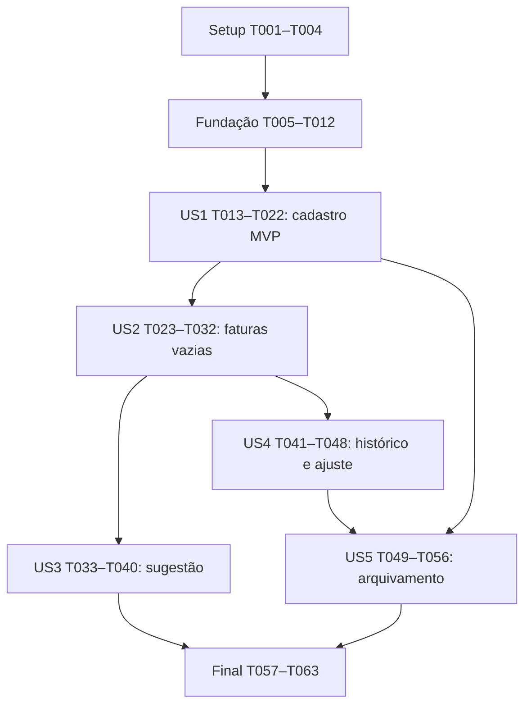

# Tasks: Cartões e ciclos de faturas

**Input**: Documentos de `specs/006-cartoes-ciclos-faturas/`: spec.md, plan.md, research.md, data-model.md, contracts/ e quickstart.md.

**Prerequisites**: Constituição1.2.0; base002/003/004 e incremento US1 da005. Não exigir pagamentos, séries ou demais histórias005 para entregar cartões/faturas vazias. Branch real inspecionada: develop; contexto lógico006. Nenhuma implementação é realizada pela geração destas tarefas.

**Tests**: Solicitados explicitamente em FR-022 e nos critérios da spec: calendário local, contratos, integração real/isolamento e validação de UI. Escrever os testes de comportamento antes da implementação correspondente e registrar falha relevante; não exigir que teste remoto rode antes da configuração/Rules autorizadas. Testes de regressão não validam antecipadamente funcionalidades inexistentes.

**Organization**: Fases por história, na ordem P1→P2. Caminhos são relativos à raiz do repositório. Cada tarefa tem ID único e caminho exato; `[P]` indica somente trabalho em arquivos separados, após as dependências descritas ao final. Não autoriza execução de agentes ou publicação por si só.

## Phase 1: Setup (Shared Infrastructure)

**Purpose**: Preparar evidência e harness sem atualizar stack, conectar serviços ou alterar dados reais nesta preparação.

- [X] T001 Registrar baseline de Git, versões, alterações prévias, checklist, hooks, estado parcial005 e fronteira sem compras/pagamentos em specs/006-cartoes-ciclos-faturas/validation.md; conferir package.json, package-lock.json e .specify/feature.json sem sobrescrever mudanças existentes.
- [X] T002 [P] Estender grupo literal cartoesFaturas com quatro UIDs distintos, projectId esperado e confirmação operacional de Rules em tests/integration/support/environment.ts e tests/integration/support/preflight.ts; cobrir configuração ausente/divergente e impedir conexão antecipada em tests/integration/support/cartoesFaturasEnvironment.test.ts.
- [X] T003 [P] Adicionar cartões, faturas e seus eventos ao inventário por runId/UID/ID exato em tests/integration/support/manifest.ts e validações em tests/integration/support/cartoesFaturasManifest.test.ts; conferir tests/integration/support/clients.ts e tests/integration/support/cleanup.ts sem abrir delete no cliente, criar seed ou executar limpeza.
- [X] T004 Documentar configuração/execução do grupo006 em .env.integration.example e specs/006-cartoes-ciclos-faturas/quickstart.md, com parâmetros sem valores secretos, pré-requisitos A/B/ADMIN/PENDING/visitante, limites do escopo e distinção entre gerado, publicado e validado; ajustar vitest.integration.config.ts apenas se necessário para selecionar o novo grupo.

## Phase 2: Foundational (Blocking Prerequisites)

**Purpose**: Contratos e calendário compartilhados que bloqueiam todas as histórias. Não habilitar mutações remotas nesta fase.

- [X] T005 [P] Definir DTOs/portas/envelopes discriminados para cartões, faturas, prévia, recibos, cursores e retornos confirmado/existente/semAlteracao em src/domain/finance/contracts/cartoes.ts e src/domain/finance/contracts/faturas.ts, conforme data-model.md e contracts/commands.md; fixar ID remoto cartaoId__YYYY-MM, tipos de comando, schema1/versaoConteudo1 e limites sem ampliar Colecao da004.
- [X] T006 [P] Acrescentar resultados esperados independentes em src/domain/finance/invoiceCalendar.test.ts para30/31 em fevereiro/março/abril2027 e fevereiro2028,31/31,31/5,2000/2100,1900/9999, compra no fechamento e igualdade sem âncoras rejeitada; registrar falha do comportamento antigo antes de corrigi-lo.
- [X] T007 Implementar calendário v2 em src/domain/finance/invoiceCalendar.ts usando src/domain/finance/calendar.ts: decidir relação mensal antes do ajuste ao último dia, aceitar igualdade somente com prova nominal, preservar metadados e leitura discriminada de legado estritamente válido, sem inferir âncoras ou recalcular snapshots.
- [X] T008 Harmonizar consumidores e regressões em src/domain/finance/contracts/commands.ts, src/domain/finance/installments.ts, src/domain/finance/settlement.ts, src/domain/finance/contracts/seriesDouble.testSupport.ts, src/domain/finance/fixtures.testSupport.ts, src/domain/finance/installments.test.ts e src/domain/finance/settlement.test.ts; registrar especialização006 em specs/003-nucleo-financeiro-compartilhado/contracts/domain.md e specs/003-nucleo-financeiro-compartilhado/contracts/repositories.md sem mudar fatos históricos ou habilitar séries remotas.
- [X] T009 Preparar helpers compartilhados de schema/data/ID e autorização ready/cutoff em firestore.rules, mantendo novos caminhos fechados até os ramos específicos das histórias; preservar integralmente002/004/005, não adicionar bypass admin, backend financeiro ou validação duplicada que estoure orçamento.
- [X] T010 [P] Testar e implementar limpeza de lilica-cartoes-faturas-pendente e descarte por geração/UID em src/app/session/financeSession.ts e src/app/session/cartoesFaturasSession.test.ts; preservar limpeza das intenções anteriores e nunca persistir payload financeiro completo no sessionStorage.
- [X] T011 [P] Definir perfis006 específicos como validacaoRemotaPendente e testes de limites em src/domain/finance/operationBudget.ts e src/domain/finance/operationBudget.test.ts: criar/editar7, arquivar5, confirmar15, ajustar5 acessos conservadores, pior escrita7, duas mutações; não promover perfil da005 ou habilitar adaptador genérico.
- [X] T012 Executar regressões do núcleo, contratos e sessão, lint/typecheck e revisão constitucional da fundação; registrar resultados reais e eventuais bloqueios em specs/006-cartoes-ciclos-faturas/validation.md, confirmando que igualdade excepcional, legado e vínculo de vencimento da parcela continuam coerentes antes de iniciar histórias.

**Checkpoint**: Contratos/calendário/sessão preparados; nenhum caso006 pode alegar autorização remota validada apenas por esses testes.

## Phase 3: User Story 1 — Cadastrar e identificar meus cartões (Priority: P1) — MVP

**Goal**: Criar, consultar e editar cartões próprios por banco/nome/titular e dias válidos, sem dados bancários sensíveis.

**Independent Test**: Criar dois cartões fictícios do mesmo banco/nome com titulares distintos, recarregar e editar; comprovar identidades separadas, preservação do titular posteriormente arquivado e rejeição de campos/referências inválidos. Não exige faturas, compras ou pagamento.

### Tests for User Story 1

- [X] T013 [P] [US1] Escrever testes de cadastro/edição e canonicalização em src/domain/finance/cartoes.test.ts para nomes/banco trim1–120, dias inteiros1–31, duplicados permitidos, identidade estável, titular novo ativo e vínculo idêntico arquivado preservado, revisão obsoleta e campos proibidos/extra.
- [X] T014 [P] [US1] Escrever contrato da porta e testes do mapeamento/adaptador em src/domain/finance/contracts/cartoes.contract.test.ts, src/infrastructure/firebase/cartoesMapper.test.ts e src/infrastructure/firebase/cartoesRepository.test.ts: recibo primeiro, mesmo conteúdo versus conflito, semAlteracao sem recibo, resposta perdida pós-commit e erro/sessão tardia sem falso sucesso.
- [X] T015 [P] [US1] Preparar casos reais positivos/negativos em tests/integration/cartoes.integration.test.ts para A/B/ADMIN/PENDING/visitante, campos sensíveis, titular alheio/ausente/arquivado, primário/recibo órfão e reaproveitamento de evento; inventariar todas as fixtures sem executar antes dos gates.

### Implementation for User Story 1

- [X] T016 [US1] Implementar validação/transições puras criarCartao/editarCartao, descritor e comparação canônica em src/domain/finance/cartoes.ts, com chave/ID estáveis por intenção, expectedVersion seguro, resultado semAlteracao e rejeição de alteração de proprietário/esquema.
- [X] T017 [US1] Implementar schema fechado e decodificação contextual de cartão/recibo em src/infrastructure/firebase/cartoesMapper.ts, recusando dados incompatíveis em vez de truncar/adotar documentos e mantendo UID/ID derivados do caminho.
- [X] T018 [US1] Implementar criar/editar/obter/listar/consultarOperacao em src/infrastructure/firebase/cartoesRepository.ts com recibo antes de estado das referências, leituras antes de escritas, cartão+evento atômicos, nomes duplicados e paginação1–50, conflitos explícitos, recuperação da mesma chave e descarte por geração.
- [X] T019 [US1] Implementar get/list e create/editar de cartoes e operacoesCartoes em firestore.rules com grafo recíproco ultimoEventoId/resultVersion, esquema/tipos/refs próprios e proteção de primeiro acesso; manter arquivamento ainda negado até US5, assim como delete/reativação e toda superfície financeira fora do escopo.
- [X] T020 [US1] Entregar firestore.indexes.json completo com cartoes(estado,nome), operacoesCartoes(alvoId,resultVersion) e isenções de mapas do recibo, preservando índices existentes; atualizar docs/firestore-rules-changes.md e preparar docs/firestore-rules-006-safe-rollback.rules para este incremento protegido, sem publicar automaticamente.
- [X] T021 [US1] Implementar src/features/cartoes/CartoesPage.tsx, src/features/cartoes/CartaoForm.tsx, src/features/cartoes/cartoesState.ts e src/features/cartoes/useCartoesRepository.ts, integrando /app/cartoes em src/app/router.tsx e src/app/AppShell.tsx; incluir rótulos/teclado, seleção paginada de titulares, vínculo histórico legível, erros/envio/retomada e aviso sobre padrões versus faturas confirmadas.
- [ ] T022 [US1] Validar o MVP por testes locais, compilação/avaliação oficial da fonte integral, casos reais T015 e fluxo manual de criação/edição após publicação autorizada e conferida; registrar revisão/índices/evidências e limites em specs/006-cartoes-ciclos-faturas/validation.md, sem marcar integração concluída se ambiente/autorizações faltarem.

**Checkpoint MVP**: Cadastro/consulta/edição utilizáveis e independentes. Arquivamento entra na US5; não oferecer ação ainda negada. T022 é gate do checkpoint, não autorização implícita de publicação.

## Phase 4: User Story 2 — Consultar faturas vazias e seus próprios calendários (Priority: P1)

**Goal**: Consultar períodos, distinguir prévia de confirmação e fixar fatura vazia única com calendário histórico e ciclo derivado.

**Independent Test**: Com cartão ativo preparado, confirmar períodos vazios antes/no/depois do fechamento, recarregar e verificar datas da tabela do modelo, total zero sem pagamento, unicidade, fronteiras adjacentes e rejeição de sobreposição à distância2. Não exige US3/US4/US5.

### Tests for User Story 2

- [X] T023 [P] [US2] Escrever testes de construção/estado e porta em src/domain/finance/faturas.test.ts e src/domain/finance/contracts/faturas.contract.test.ts para tabela de calendário, limites compartilhados somente de snapshots preexistentes, ausências que exigem padrão e rejeição de origem circular; cobrir ordem retroativa, meses±2, bordas de ano, fechamento derivado e nenhum pagamento/atraso fictício.
- [X] T024 [P] [US2] Escrever testes de schema/identidade, transação e consultas em src/infrastructure/firebase/faturasMapper.test.ts, src/infrastructure/firebase/faturasRepository.test.ts e src/infrastructure/firebase/faturasQueries.test.ts, cobrindo pré-estado/ausências dos quatro vizinhos sem usar outro documento novo como origem, mesmo período concorrente, cartão alterado, existente sem recibo novo e choque com documento incompatível.
- [X] T025 [P] [US2] Preparar testes remotos em tests/integration/faturas.integration.test.ts para unicidade, quatro vizinhos, fronteiras, ordem inversa, escrita direta, recibos e papéis. Incluir: outubro/2026 sob30/31 fecha30/10 e vence31/10; novembro ausente; após mudar para25/5, dezembro proposto inicia25/10, fecha25/11 e vence05/12, negado por sobreposição; em execução independente confirmar dezembro sob25/5, mudar para30/31 e tentar outubro, também negado. Incluir ramo máximo com vizinhos preexistentes e ausentes; lote direto criando outubro/novembro sob10/17 mais recibos com fronteira inventada12/10 deve negar integralmente, enquanto controle positivo com10/10 e origens padrao deve aceitar, respeitados os demais limites.

### Implementation for User Story 2

- [X] T026 [US2] Implementar construção por competência, comparação de calendários, prova de janelas mensais/ausência de sobreposição e ciclo derivado em src/domain/finance/faturas.ts; herdar somente snapshots válidos no pré-estado, calcular pelo padrão validado quando o vizinho era ausente e impedir origem circular entre novas faturas; exigir igualdade de fronteiras±1 e separação±2, sem reescrever passado ou criar vizinhos automaticamente.
- [X] T027 [US2] Implementar src/infrastructure/firebase/faturasMapper.ts com fatura schema1/versaoConteudo1, calendarioOrigem v2 e identidade cartaoId__competencia verificável; rejeitar total/itens/pagamento/ciclo autoritativo, âncoras inventadas e documentos antigos desconhecidos sem migração silenciosa.
- [X] T028 [US2] Implementar confirmar/obter/listar/consultarOperacao em src/infrastructure/firebase/faturasRepository.ts e consultas em src/infrastructure/firebase/faturasQueries.ts: recibo primeiro, leitura transacional de F/C/quatro vizinhos no pré-estado inclusive ausentes, revisão do cartão da prévia, duas escritas atômicas, existente versus conflito e paginação por cartão/competência sem varrer histórico; não usar escrita planejada de outro período como snapshot histórico.
- [ ] T029 [US2] Implementar get/list e create vazio de faturas/operacoesFaturas em firestore.rules com ID determinístico, snapshot do cartão ativo, clamp nominal e fronteiras/janelas±1/±2. Consultar os quatro vizinhos por get no pré-estado: somente snapshot válido preexistente fornece limite; ausência anterior exige origem padrao, inclusive quando outro período nasce no mesmo lote. Manter getAfter para cartão/recibo e grafo recíproco; negar lote circular12/10 e aceitar controle10/10 sob10/17, respeitando demais invariantes. Manter update negado até US4 e não abrir itens/fatos financeiros.
- [X] T030 [US2] Atualizar firestore.indexes.json completo para faturas(cartaoId,competencia), operacoesFaturas(alvoId,resultVersion) e isenções de calendarioOrigem/mapas dos eventos; atualizar docs/firestore-rules-changes.md e docs/firestore-rules-006-safe-rollback.rules preservando entregas anteriores.
- [X] T031 [US2] Implementar src/features/cartoes/FaturasPage.tsx, src/features/cartoes/FaturaDetailPage.tsx e src/features/cartoes/faturasState.ts, ligando rotas protegidas de cartão/período em src/app/router.tsx; apresentar prévia sem escrita, confirmação explícita, ciclo derivado, nomes atuais, ausência/total0/sem pagamento e navegação entre anos.
- [ ] T032 [US2] Executar regressões e avaliar oficialmente Rules completas para ramo máximo15 acessos/pior escrita7/limite1000 expressões, comprovando substituição de quatro getAfter de vizinhos por quatro get, sem duplicar leituras. Avaliar também lote direto de duas faturas/recibos com16 acessos das escritas no desenho: origem circular12/10 negada e controle10/10 aceito sob10/17; a rejeição não pode decorrer apenas de orçamento. Após publicação autorizada conferida, executar T025 e interface vazia; registrar os dois controles, fixture válida de distância2, concorrência, unicidade e consulta sem escrita em specs/006-cartoes-ciclos-faturas/validation.md.

**Checkpoint**: Faturas vazias consultáveis e confirmáveis com identidade única, sem compras, pagamentos ou ajuste manual ainda.

## Phase 5: User Story 3 — Sugerir e corrigir a primeira fatura (Priority: P1)

**Goal**: Sugerir a fatura pela data e pelos ciclos concretos, mantendo seleção explícita do usuário sem criar lançamentos.

**Independent Test**: Informar compra antes/no/depois do fechamento, incluindo30/31 em fevereiro e25/5 em dezembro; escolher outro período/fechado e confirmar que a escolha permanece, sem qualquer escrita de compra, parcela, pagamento ou fatura pela prévia.

### Tests for User Story 3

- [X] T033 [P] [US3] Acrescentar testes de resolução de primeira fatura em src/domain/finance/faturas.test.ts para início inclusivo/fechamento exclusivo, snapshots prioritários, candidatos novos, escolha explícita distante/fechada, ausência/ambiguidade, data futura válida e bloqueio de cartão arquivado.
- [X] T034 [P] [US3] Acrescentar testes de consulta de contenção e deduplicação em src/infrastructure/firebase/faturasQueries.test.ts para limite2, dois snapshots conflitantes, mesmo snapshot encontrado duas vezes, sete competências auxiliares no máximo, índice ausente e fontes/gerações divergentes sem alegar confirmação.

- [X] T035 [P] [US3] Acrescentar casos reais de contenção, correção de período e ausência de efeitos financeiros em tests/integration/faturas.integration.test.ts, verificando snapshots históricos diferentes do padrão atual, virada de ano e falta de índice sem consulta ilimitada.

### Implementation for User Story 3

- [X] T036 [US3] Implementar resolvedor puro em src/domain/finance/faturas.ts combinando snapshots com candidatos das competências do mês da compra,+1,+2; validar cada candidato/vizinhança, retornar sugestão única/ausência/conflito e conservar escolha explícita sem reatribuição automática.
- [X] T037 [US3] Implementar PortaPreviaFatura e leitura remota de contenção em src/infrastructure/firebase/faturasQueries.ts, com cartaoId/inicio<=compra/fechamento>compra, limite2, busca auxiliar deduplicada e validação de revisão/schema; nenhuma escrita nem fallback de baixar todo o histórico.
- [X] T038 [US3] Acrescentar índice faturas(cartaoId,inicio,fechamento) em firestore.indexes.json, preservar índices/isenções e descrever consultas exigidas e tratamento de configuracaoPendente em docs/firestore-rules-changes.md; verificar que os matches de leitura006 autorizam somente o próprio usuário e limit apropriado.
- [X] T039 [US3] Implementar src/features/cartoes/PrimeiraFaturaPreview.tsx e integrá-lo em src/features/cartoes/FaturasPage.tsx com dataCompra, calendário/origem da sugestão, explicação da convenção do fechamento e seleção explícita; manter escolha em src/features/cartoes/faturasState.ts, sem botão que aparente registrar compra.
- [ ] T040 [US3] Executar contratos/testes de consultas e, no ambiente autorizado com índice pronto, os casos de T035 e verificação manual da prévia; registrar em specs/006-cartoes-ciclos-faturas/validation.md evidência de zero escritas por previsão e limites da leitura não isolada até a confirmação final.

**Checkpoint**: Sugestão explicável e corrigível, estritamente como prévia, sem ampliar o cadastro para compras reais. T035 prepara os casos reais antes de T036–T039; sua execução ocorre somente em T040.

## Phase 6: User Story 4 — Alterar calendário sem reescrever o passado (Priority: P1)

**Goal**: Editar padrões do cartão sem modificar faturas confirmadas e ajustar só o vencimento da fatura selecionada com histórico.

**Independent Test**: Confirmar outubro/novembro, editar padrões, conferir snapshots e criar período ainda não confirmado; ajustar17/10→19/10 e verificar anterior/novo/motivo, mesma identidade/limites, demais meses intactos e nenhuma movimentação.

### Tests for User Story 4

- [X] T041 [P] [US4] Acrescentar testes de preservação/ajuste em src/domain/finance/cartoes.test.ts e src/domain/finance/faturas.test.ts para períodos confirmados futuros/vazios, novo padrão, mesmo mês, exceção de igualdade pelo snapshot, motivo obrigatório, semAlteracao, datas úteis sem deslocamento e schema futuro recusado.
- [X] T042 [P] [US4] Acrescentar testes de ajuste/recibo em src/infrastructure/firebase/faturasRepository.test.ts e src/infrastructure/firebase/faturasMapper.test.ts para antes/novo exatos, conflito entre duas revisões, perda de resposta, schema com itens não suportado e nenhum efeito parcial em datas/vínculos.

- [X] T043 [P] [US4] Acrescentar testes reais de ajuste válido/ataques diretos em tests/integration/faturas.integration.test.ts para outro mês, anterior ao fechamento, igualdade sem prova, troca de identidade/limites/snapshot, evento órfão/reutilizado e duas edições concorrentes.

### Implementation for User Story 4

- [X] T044 [US4] Implementar planejarAjusteVencimento em src/domain/finance/faturas.ts e conferir editarCartao em src/domain/finance/cartoes.ts: ajuste usa âncoras históricas, preserva identidade/limites/calendarioOrigem e bloqueia variantes com itens; padrão novo afeta só períodos não confirmados, sem varredura/cascata.
- [X] T045 [US4] Implementar ajustarVencimento e leitura paginada de eventos em src/infrastructure/firebase/faturasRepository.ts, src/infrastructure/firebase/faturasMapper.ts e src/infrastructure/firebase/faturasQueries.ts, com fatura+evento atômicos, motivo/anterior/novo, recibo primeiro, versão esperada e nenhuma exigência de cartão ativo para obrigação existente.
- [ ] T046 [US4] Habilitar somente update de vencimento permitido e evento ajustarVencimento em firestore.rules, comprovando before contra resource.data, mapa/schema/identidade/limites imutáveis, datas do mês e igualdade excepcional pelo snapshot; atualizar docs/firestore-rules-changes.md e docs/firestore-rules-006-safe-rollback.rules sem abrir itens/pagamentos.
- [X] T047 [US4] Acrescentar formulário de ajuste/histórico em src/features/cartoes/FaturaDetailPage.tsx e estado de revisão/envio em src/features/cartoes/faturasState.ts, mostrando impacto e motivo, mantendo contexto da fatura e exigindo releitura informada em conflito, sem alterar outros períodos ou padrão cadastral.
- [ ] T048 [US4] Compilar/avaliar fonte integral e orçamento5 para ajuste; executar regressões, os casos de T043 e fluxo manual após habilitação autorizada, registrando preservação integral dos snapshots e histórico rastreável em specs/006-cartoes-ciclos-faturas/validation.md, sem alegar integração de cópias de parcelas ainda não entregues.

**Checkpoint**: Mudança cadastral não reescreve histórico e ajuste da fatura é explícito/rastreável; variante vazia permanece sem pagamentos. T043 prepara casos reais antes da implementação; execução somente em T048.

## Phase 7: User Story 5 — Arquivar sem perder obrigações (Priority: P2)

**Goal**: Arquivar cartão conservando faturas/obrigações e impedindo uso para novas compras futuras ou novos períodos vazios.

**Independent Test**: Arquivar cartão com faturas futuras confirmadas; consultar histórico, recuperar recibo anterior e ajustar vencimento existente. Nova confirmação vazia/prévia de compra é bloqueada, sem exclusão/reativação. Preservação de parcelas já confirmadas é validada por contrato/double003, pois compras remotas não são entregues aqui.

### Tests for User Story 5

- [X] T049 [P] [US5] Acrescentar testes de arquivamento em src/domain/finance/cartoes.test.ts e src/domain/finance/contracts/cartoes.contract.test.ts, incluindo no-op na revisão atual, edição embutida negada e preservação de obrigações/parcelas futuras em double identificado, sem abrir coleções remotas para demonstrá-las.
- [X] T050 [P] [US5] Acrescentar testes de adaptador em src/infrastructure/firebase/cartoesRepository.test.ts e src/infrastructure/firebase/faturasRepository.test.ts para arquivamento concorrente com confirmação, formulário obsoleto, recuperação de recibo após arquivar e consulta/ajuste de fatura preservada.

- [X] T051 [P] [US5] Acrescentar casos reais de arquivamento/rejeição de reativação/delete/edição embutida, cartões de mesmo banco separados, confirmação concorrente e ajuste após arquivar em tests/integration/cartoes.integration.test.ts e tests/integration/faturas.integration.test.ts; incluir tentativas diretas do proprietário e papéis indevidos.

### Implementation for User Story 5

- [X] T052 [US5] Implementar transição arquivarCartao em src/domain/finance/cartoes.ts e garantir bloqueio de prévia para cartão arquivado em src/domain/finance/faturas.ts, preservando todos os dados/obrigações, sem cancelamento, quitação, reativação ou exclusão.
- [X] T053 [US5] Implementar arquivamento atômico/revisão/no-op em src/infrastructure/firebase/cartoesRepository.ts e conferir guards em src/infrastructure/firebase/faturasRepository.ts e src/infrastructure/firebase/faturasQueries.ts: novo período exige ativo no commit; consulta/recuperação/ajuste de existente continuam válidos; não revalidar atividade antes de recibo confirmado.
- [X] T054 [US5] Habilitar arquivamento estrito de cartão/evento em firestore.rules, mantendo conteúdo anterior e negando edição/reativação/delete; provar que criação de nova fatura exige cartão ativo pós-estado, sem cascata de atualização nas faturas; atualizar docs/firestore-rules-changes.md e docs/firestore-rules-006-safe-rollback.rules.
- [X] T055 [US5] Integrar confirmação de impacto/ação arquivar e filtros ativos/arquivados/todos em src/features/cartoes/CartoesPage.tsx e src/features/cartoes/cartoesState.ts; adaptar src/features/cartoes/FaturasPage.tsx e src/features/cartoes/FaturaDetailPage.tsx para histórico legível e ausência sem botão de nova confirmação no arquivado.
- [ ] T056 [US5] Executar regressões, avaliação oficial do ramo de arquivamento5 e os casos de T051 no projeto autorizado, mais conferência manual de faturas/obrigações preservadas e explicação da fronteira de compras futuras; registrar resultados e limitações específicas em specs/006-cartoes-ciclos-faturas/validation.md.

**Checkpoint**: Todas as histórias estão entregues sem habilitar cadastro de compras ou pagamentos. Arquivar não altera compromisso ou histórico; prova integrada de compra nova versus arquivamento é obrigação do futuro consumidor. T051 prepara casos reais antes da implementação; execução somente em T056.

## Phase 8: Polish & Cross-Cutting Concerns

**Purpose**: Consolidar evidências finais, entregas de segurança e critérios de sucesso sem repetir verificações estáveis sem motivo.

- [X] T057 Executar npm run lint, npm run typecheck, npm test, npm run build e verificação de diffs, cobrindo arquitetura do domínio em src/domain/finance/architecture.test.ts e regressões002/003/004/005; revisar também acessibilidade, ausência de payloads sensíveis em logs e mensagens de erro sanitizadas, registrando resultados em specs/006-cartoes-ciclos-faturas/validation.md.
- [ ] T058 Consolidar firestore.rules, firestore.indexes.json, docs/firestore-rules-changes.md e docs/firestore-rules-006-safe-rollback.rules completos; revisar todos os ramos/ataques de contracts/security.md, contagem sem cache, expressões e compatibilidade. Compilar/avaliar a fonte integral final se mudou desde o último checkpoint, sem confundir compilação com autorização ativa.
- [ ] T059 Preparar comparação/backup da revisão ativa, inventário autorizado de colisões/schema preexistente, situação dos índices e impacto/rollback em specs/006-cartoes-ciclos-faturas/deployment-review.md; efetuar publicação006 somente se autorizada e sem divergência não contemplada, conferindo depois fonte e índices READY. Se não autorizada, deixar este gate e dependentes pendentes, preservando todo o trabalho local revisável.
- [ ] T060 Executar a matriz real final de tests/integration/cartoes.integration.test.ts e tests/integration/faturas.integration.test.ts após T059 e preflight, incluindo quatro papéis/visitante, campos proibidos, conteúdo/identidades imutáveis, concorrência, casos máximos e confirmação perdida; registrar execução em specs/006-cartoes-ciclos-faturas/validation.md e inventariar fixtures sem limpeza automática.
- [ ] T061 Validar interface completa em celular/desktop/teclado e medir com cinco participantes SC-001/SC-008 conforme specs/006-cartoes-ciclos-faturas/quickstart.md; registrar tempos, conclusão e entendimento em specs/006-cartoes-ciclos-faturas/validation.md, marcando medição pendente se participantes não estiverem disponíveis.
- [X] T062 Promover apenas os perfis006 efetivamente comprovados para validadoNoProjeto em src/domain/finance/operationBudget.ts e atualizar src/domain/finance/operationBudget.test.ts com evidência de T060; manter ramos não executados pendentes, sem habilitar comandos genéricos de séries/compras/liquidações.
- [X] T063 Atualizar README.md, specs/006-cartoes-ciclos-faturas/quickstart.md e specs/006-cartoes-ciclos-faturas/validation.md com uso/limitações, comandos realmente executados, estado gerado/compilado/publicado/verificado, rastreabilidade FR/SC, fronteira sem compras/pagamentos, pendências assistidas e limpeza somente por manifesto autorizado; reexecutar checks apenas se mudanças novas justificarem.

## Continuidade autorizada em2026-10-18

Após o bloqueio remoto de T022, o responsável solicitou: “Então continue, mesmo assim”. Concluir as entregas locais das demais histórias sem exigir antes os gates remotos. T022/T032/T040/T048/T056 e a consolidação remota/assistida permanecem pendentes; esta exceção de ordem não autoriza publicação nem dispensa a validação. Evidência em validation.md.

## Dependencies & Execution Order

### Phase Dependencies

Setup T001→(T002 e T003)→T004. Fundação: T005 e T006 podem começar juntos após Setup; T007 depende de T006 e T008 depende de T005/T007. T009/T010/T011 podem avançar em arquivos separados após T008; T012 reúne a validação e bloqueia o início das histórias.

Dentro de cada história, testes precedem implementação correspondente; os testes paralelos podem ser escritos juntos após fundação/dependências. Não executar integração antes de fonte/indexação/configuração/autorização válidas. Cada checkpoint exige evidência local e a distinção explícita de qualquer gate remoto/assistido pendente.

Protocolo comum aos checkpoints T022/T032/T040/T048/T056: preparar entregas locais completas, compilar/avaliar fonte quando alterada, comparar/guardar backup do ativo e registrar impacto em specs/006-cartoes-ciclos-faturas/deployment-review.md; somente sob autorização vigente publicar o incremento e conferir fonte/índices antes dos testes reais. Esse protocolo é aplicado no checkpoint correspondente e não depende de chegar a T059, que consolida a revisão final. Se não houver autorização/configuração, concluir trabalho local e registrar o gate remoto pendente sem ampliar privilégios ou declarar a história validada remotamente.

US1 não depende de outras histórias. US2 precisa de cartão ativo da US1, preparado sem compra. US3 e US4 dependem de US2, mas não uma da outra funcionalmente. US5 usa US1 e US2; seu aceite de ajuste após arquivar depende do ajusteUS4. Testes/doubles permitem preparar esses pré-requisitos sem ampliar funcionalidades. A ordem de execução recomendada é US1→US2→US3→US4→US5, evitando disputa de arquivos compartilhados.

### Dependências específicas dentro das histórias

- US1: T013/T014/T015 em paralelo; T016→T017→T018→T019→T020→T021→T022. A prova oficial/publicação de T022 exige entregas completas de T019/T020; T021 pode ser demonstrada com double até o ambiente real estar pronto, sem declarar persistência.
- US2: T023/T024/T025 em paralelo após US1; T026→T027→T028→T029→T030→T031→T032.
- US3: T033/T034/T035 em paralelo; T036→T037→T038→T039→T040. T035 é preparação dos testes reais, não sua execução.
- US4: T041/T042/T043 em paralelo; T044→T045→T046→T047→T048.
- US5: T049/T050/T051 em paralelo; T052→T053→T054→T055→T056.
- Final: T057→T058→T059→T060→T061→T062→T063; T061 assistida pode ocorrer após ambiente pronto em paralelo à revisão de evidência T060, mas não deve usar os mesmos registros de disputa. Verificações já aprovadas só repetem se houve alteração/falha/risco novo.

### Parallel Opportunities

Os marcadores `[P]` identificam arquivos separados, não independência de pré-requisitos. Não paralelizar edições em firestore.rules, firestore.indexes.json, router.tsx, validation.md ou módulos faturas/cartoes compartilhados. US3 e US4 são independentes como comportamento, mas alteram arquivos em comum: executá-las sequencialmente ou dividir explicitamente arquivos antes de qualquer trabalho simultâneo. Nenhuma tarefa exige agentes adicionais.

## Parallel Examples by User Story

| História | Exemplo seguro após pré-requisitos |
| --- | --- |
| US1 | T013 domínio, T014 porta/mapeadores/adaptador e T015 integração em arquivos distintos; só depois implementar. |
| US2 | T023 domínio/porta, T024 adaptadores/consultas e T025 integração em arquivos distintos. |
| US3 | T033 regras de sugestão, T034 consulta de contenção e T035 integração, antes de T036–T039. |
| US4 | T041 domínio, T042 adaptadores e T043 casos de integração, antes de T044–T047. |
| US5 | T049 domínio/contrato, T050 adaptador e T051 integração, antes da transição e Rules de arquivamento. |

## Implementation Strategy

### MVP First

Concluir Setup, Fundação e US1 (T001–T022). Esse MVP entrega cadastro/consulta/edição de cartões e valida isolamento, referências e retomada sem depender de compras. Seu checkpoint não encerra a feature completa e não oferece arquivamento ainda negado. Demonstrar resultado concreto e registrar eventual bloqueio remoto; não solicitar publicação antes de ter Rules/índices/notas/rollback revisáveis.

### Incremental Delivery

Adicionar US2 e conferir calendários/vizinhos; depois US3 para previsão corrigível; US4 para preservação/ajuste; US5 para encerrar uso sem perder obrigações. Cada incremento passa pelos testes e revisão de segurança pertinentes. Para publicação incremental autorizada, habilitar somente os comandos já implementados/avaliados; futuras transições ficam negadas. Evidência antiga005 nunca promove perfil006.

### Completion and Traceability

| Cobertura | Tarefas principais |
| --- | --- |
| FR-001–003 cadastro/privacidade/referências | T005,T013–T022,T049–T056 |
| FR-004–008 identidade/calendário/snapshots | T006–T008,T023–T032,T041–T048 |
| FR-009–010 ajuste sem inconsistência | T041–T048,T055–T056 |
| FR-011–013 sugestão/escolha sem escrita | T033–T040 |
| FR-014–017 consulta/ciclo/zero sem pagamento | T023–T032,T039,T055 |
| FR-018 arquivamento | T049–T056; contrato de consumo futuro explicitamente limitado |
| FR-019–023 confiabilidade/segurança/UI | T002–T012, adaptadores/Rules/UI de cada história,T057–T063 |
| SC-001/008 tempo e compreensão | T061 |
| SC-002/004 calendário e sugestão | T006–T008,T023–T040 |
| SC-003 snapshots e ajuste | T041–T048 |
| SC-005 unicidade/concorrência | T024–T032,T043,T048,T060 |
| SC-006 preservação e bloqueio pós-arquivamento | T049–T056; compras futuras não são aceitação remota006 |
| SC-007 isolamento/campos proibidos/confirmação | T010,T014–T022,T025,T032,T043,T048,T051,T056,T060 |

Critério de marcação: `[x]` somente com entrega e evidência correspondente; não marcar tarefa real/assistida como concluída com double, fonte compilada ou impressão do implementador. Não fabricar pagamentos, migrar documentos silenciosamente, publicar/excluir por inferência ou alterar a constituição para simplificar implementação.

## Notes

Gerado em2026-10-18. Hooks before_tasks/after_tasks: `.specify/extensions.yml` ausente, sem execução aplicável. Testes descritos são trabalho futuro; este documento não implementa funcionalidades, publica regras ou altera dados reais. Validação da geração:63 tarefas (US1:10; US2:10; US3:8; US4:8; US5:8; compartilhadas:19),21 marcadas [P]; IDs sequenciais, rótulos e caminhos conferidos, sem tarefas executadas.
